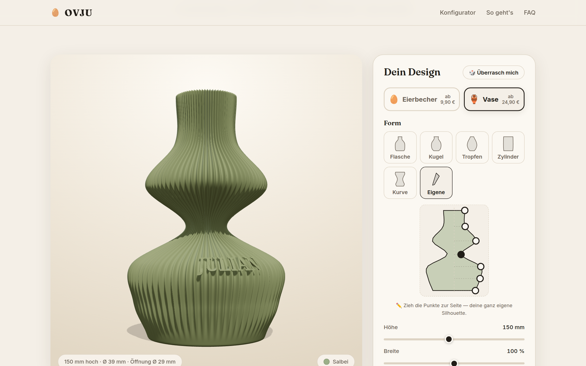

# formsam — Vasen selbst gestalten

**Sorgsam geformt. Auf dich zugeschnitten.** — Web-Konfigurator und Shop für individuell gestaltete, 3D-gedruckte **Vasen**.
Du entwirfst Form, Oberfläche, Farbe und Gravur live in 3D; gedruckt wird erst, wenn bestellt wird — einzeln, in Deutschland, aus PLA.

Marke, Farben, Schriften und Logo-Dateien: [docs/marke.md](docs/marke.md).

> **Eierbecher sind per Schalter deaktiviert** (Admin → System → „Eierbecher als Produkt anbieten“, Standard: aus).
> Code, Geometrie, alte Bestellungen und gespeicherte Designs bleiben erhalten; der Server nimmt Eierbecher-Positionen
> nicht an, solange der Schalter aus ist. Einschalten macht das Produkt ohne Code-Änderung wieder bestellbar.




## Studio-Redesign

Interaktive 3D-Formenwelt mit sechs direkt übernehmbaren Entwürfen, Live-Silhouetteneditor, KI-Produktfotos auf Basis der tatsächlichen Modelle, Scroll-Animationen, Darkmode und responsivem Layout. Die Szenen pausieren außerhalb des Sichtbereichs und respektieren reduzierte Bewegung. Gestaltung und Bildherkunft: [docs/studio-redesign.md](docs/studio-redesign.md).

## Oberflächen & Szenen

15 neu generierte FDM-Motive: sechs Formenkarten, vier Kampagnenszenen, drei Hammerschlag-Nahaufnahmen sowie Voronoi und Fjordwelle. Alle Materialien zeigen horizontale Druckschichten, auch glänzendes und metallisch schimmerndes PLA. Optimierte WebP-Dateien werden auf der Website verwendet; die PNG-Originale und exakten Prompts sind unter [Bilder und Prompts](docs/generated-scenes.md) dokumentiert. Die Formenkarten (`fdm-card-*.webp`, `fdm-hammer-copper`, `fdm-voronoi`, `fdm-fjord`) gibt es zusätzlich in 700 px Breite (`…-700.webp`, ≈ ¼ der Dateigröße); `studio.js` bietet beide per `srcset` an (Anzeige ≈ 400 CSS-px, hochauflösende Displays nehmen das Original). **Wer ein Motiv austauscht, erzeugt die 700-px-Fassung mit** (gleiches Seitenverhältnis), sonst zeigen normale Displays noch das alte Bild.

**Voronoi** (Muster-ID `skelett`): Vasen erhalten echte unregelmäßige Zellöffnungen mit verbundenen Stegen, stabilem Fuß und geschlossenem Rand. (Eierbecher — derzeit deaktiviert — behalten eine geschlossene Mulde und zeigen das Muster als Relief.) Gravuren erhalten eine geschlossene Auflage. Prüfung: `node tools/check-skeleton.mjs` und `node tools/check-voronoi-topology.mjs`.

**Fjordwelle** (Muster-ID `koralle`): feine geschwungene Rippen auf weiten Wellen. Die Oberfläche bleibt geschlossen; Tiefe bis 6 mm bei Vasen. Prüfung: `node tools/check-coral.mjs`.

Die sieben ursprünglichen Muster bleiben geometrisch unverändert. Ein physischer Probedruck der neuen Muster steht aus; bei Voronoi sind Brücken und gegebenenfalls Stützen im Slicer zu prüfen.

## Features

- **Vasen** (Flasche/Kugel/Tropfen/Zylinder/Kurve), Höhe & Breite frei ziehbar. Eierbecher (Kelch/Schale/Tulpe) sind im Code vorhanden, aber per Schalter deaktiviert (siehe oben)
- **Formen-Editor „Eigene"**: Silhouetten-Punkte per Drag ziehen — komplett eigene Formen; auch per Tastatur (Punkt mit Tab anwählen, Pfeiltasten ±2 %, Bild auf/ab ±10 %, Pos1/Ende)
- **Maße auf der Bühne**: „150 mm hoch · Ø 92 mm · Öffnung Ø 32 mm“ — „Ø“ ist die **größte Breite** der Vase inkl. Muster, Wulst und Gravur (`geometry.js` `info.maxDiameter`, weitester Punkt des Modells von der Achse; entspricht der Druckdatei), nicht mehr der obere Rand. `node tools/test-konfigurator.mjs` vergleicht sie mit der Bounding-Box der Druckdatei
- **Entwurf sichern & Zurücksetzen**: Die aktuelle Gestaltung liegt laufend im Browser (`localStorage` `ovju-entwurf`, nur auf diesem Gerät) und kommt beim nächsten Aufruf zurück — Hinweis im Panel „Dein letzter Entwurf ist wieder da · Neu beginnen“ (Handys verwerfen schwere Tabs gern beim App-Wechsel). Geladen wird über dieselbe Prüfung und Klemmung wie bei Design-Codes; ein unlesbarer oder 30 Tage nicht geänderter Stand wird gelöscht (ein bloßer Besuch schreibt den Stand nicht neu, die Frist läuft also ab der letzten Änderung), nach einer abgeschlossenen Bestellung ebenso (der offene Konfigurator behält das Design, gesichert wird wieder ab der nächsten Änderung) und mit „Zurücksetzen“/„Neu beginnen“; der unveränderte Grundzustand wird nicht gesichert und löscht keinen Entwurf von früher. Ein vor dem Laden angeklickter Entwurf der Formenwelt hat Vorrang.
  Design-Codes (Link `?d=`/`#d=`, Code-Eingabe): Der Code in der Adresse hat Vorrang. Solange das geladene Design unverändert ist, wird nichts gesichert — ein eigener, abweichender Entwurf bleibt erhalten („Dein vorheriger Entwurf ist noch gesichert · Wieder laden“). Bis die Antwort zum Link-Code da ist, wird gar nichts gesichert oder gelöscht; lässt er sich nicht laden (unbekannt, Netz, Neustart), bleibt der Entwurf gesichert und wird angeboten. Eine Änderung gleich nach dem Laden eines Codes zählt schon als Weitergestalten (der Referenzstand entsteht beim Laden). Beim ersten Weitergestalten verschwindet der Code aus der Adresse (sie zeigt dieses Design nicht mehr), Neuladen oder Tab-Verwurf bringt also den Entwurf. Der Entwurf merkt sich seinen Ursprungscode (`von`): Wer denselben Link erneut öffnet, bekommt den Entwurf mit „Original-Design laden“ (verwirft ihn, mit „Rückgängig“). „↺ Zurücksetzen“ (Panel-Kopf, im Touch-Layout am Panel-Ende) stellt alles auf den Anfang, mit „Rückgängig“
- **Oberflächen**: Glatt, Rippen, Wellen, **Lamellen** (tiefe Plissee-Schlitze bis 6 mm), Zickzack (Facetten), Querwellen, **Gehämmert** (gejittertes Kugelkalotten-Gitter mit Facettenkanten — wie handgehämmertes Metall, reproduzierbar), **Voronoi** und **Fjordwelle** — mit Anzahl, Tiefe und **Verlauf**: Spirale, Gegenläufig (V-Optik), Wellenfluss (schlängelnde Rippen) oder Zickzack, jeweils mit Stärke und Anzahl Richtungswechsel. Ästhetik-Klemmen (aus einem Multi-Agent-Design-Review abgeleitet) halten jede Kombination kontrolliert: Rippenlinien-Neigung ≤ 55–62°, Tiefe an Rippenzahl gekoppelt, Wechselzahl an Rippendichte/Höhe gekoppelt, Muster laufen an den Rändern sauber aus. Mesh-Ringe drehen mit dem Verlauf mit und die Auflösung ist ein ganzzahliges Vielfaches der Rippenzahl → Gratspitzen liegen auf jedem Ring exakt auf einem Vertex (keine „Perlenketten“ bei Drall)
- **Aktionen**: Rabatt je Muster, mehrere Aktionen gleichzeitig, Badges und Umschalt-Hinweis im Konfigurator (Admin → Aktionen). Mit einer Aktion zahlt niemand mehr als ohne: ist bei mehreren Stück der Normalpreis mit Mengenrabatt günstiger (Aktion ohne „Mengenrabatt zusätzlich“), gilt er für diese Warenkorb-Zeile — ohne Aktion, ohne Streichpreis. Ein nicht mit Aktionen kombinierbarer Gutschein wird nur abgelehnt, wenn eine Aktion in dieser Bestellung tatsächlich etwas spart. Streichpreis nach § 11 PAngV = **niedrigster Preis der letzten 30 Tage** vor Aktionsbeginn („Niedrigster Preis der letzten 30 Tage: …“), Prozentangaben beziehen sich darauf; Grundlage ist die Preis-Historie `data/preis-historie.json` (Momentaufnahme bei jedem Start und jeder Preis-/Aufpreis-/Aktionsänderung, 90 Tage). Test: `node tools/test-referenzpreis.mjs`
- **Größenaufschlag**: Preis wächst mit dem Volumen relativ zur Normalgröße (relVol = Höhe/Normalhöhe × Breite²; %- und €-Satz im Admin einstellbar, live im Konfigurator sichtbar, Server rechnet verbindlich)
- **Gravur**: zuschaltbares Extra (Aufpreis im Admin einstellbar, Standard 3 €), 7 Schriftarten (inkl. „Edel" Marcellus & „Kalligrafie" Great Vibes, OFL → Lizenzen in docs/LICENSES.md), Größe & Höhen-Position einstellbar; der Text folgt der Silhouette (Taille/Bauch) und wird um die Wand gebogen. Das Feld zeigt den Text genau so, wie er graviert wird (keine Versalien-Darstellung). Häkchen aus = keine Gravur in Preis, Code und Bestellung, der getippte Text bleibt aber im Feld und kommt mit dem Häkchen zurück. Farbschrift in derselben Farbe wie die Vase: nur ein Hinweis, keine Sperre. Die Gravurschriften (≈ 150 kB) lädt der Konfigurator erst, wenn jemand die Gravur ansteuert
- **16 PLA-Farben mit Finishes**: matt (Bambu-Matte-Palette), glänzend (Glossy) und metallic/Silk (Gold, Silber, Kupfer, Perlmutt) — Finish pro Farbe im Admin einstellbar, gerendert mit MeshPhysicalMaterial (Clearcoat/Metalness) + RoomEnvironment-Reflexionen im Studio
- **Galerie & Produktfotos**: Im Admin (Produktfotos & Galerie) hochgeladene Fotos erscheinen sofort in der „Zuhause bei formsam“-Galerie; Fotos der Kategorie Vase ersetzen die Render-Bilder der Produktkarten
- **Szenen-Vorschau**: Studio + 4 fotoreale CC0-HDRI-Szenen von Poly Haven (Esstisch mit echter Holztisch-Textur, Fensterbrett mit Ausblick, Café, Abend) — Environment-Beleuchtung, Trockengräser in der Vase
- **📸 Foto-Shooting**: rendert das aktuelle Design in 4 Szenen als speicherbare PNGs
- **Design-Codes & Listen**: jedes Design als kurzer Code zum Teilen und Nachbestellen (alte Codes bleiben gültig; ein unbekannter Code im Link `?d=`/`?l=` meldet sich mit „Diesen Design-Code gibt es nicht …“ bzw. „Diese Liste gibt es nicht …“ und verschwindet aus der Adresse, statt still das Standard-Design zu zeigen; bei vorübergehenden Fehlern — Netz weg, Neustart, Fehlerseite von nginx — kommt „… ließ sich gerade nicht laden – bitte versuch es gleich noch einmal“ und der Code bleibt in der Adresse; dasselbe deutsch im Code-Dialog und bei „Original-Design laden“. Ein Listen-Code im Code-Dialog schließt den Dialog erst, wenn die Liste geladen ist — sonst steht der Grund im Dialog), Design-Listen (z. B. für eine Hochzeit) mit Vorschau, Code und Menge — teilbar per Link. Neue Codes nur mit Werten, die der Konfigurator erzeugen kann (siehe „Eingaben & Schutz“), Eierbecher-Codes nur mit eingeschaltetem Produkt. Vorschaubild je Code: nur das erste (echtes JPEG) gilt, spätere Uploads ändern nichts — ein verunglücktes oder vorab fremd belegtes Bild entfernt der Admin unter Produktfotos & Galerie → „Vorschaubild eines Design-Codes“ (`DELETE /api/design/<CODE>/thumb` mit Admin-Passwort); sobald der Code im Shop geöffnet (Link `?d=`, Code eingeben, Listeneintrag) oder das Design gespeichert wird, lädt der Browser ein neues hoch — auch für ältere Codes, deren Konfiguration der heutige Konfigurator anders speichert. Grenzen: Wer nach dem Entfernen zuerst hochlädt, belegt den Platz wieder (dann noch einmal entfernen); frühere Betrachter sehen das alte Bild bis zu 1 Stunde aus ihrem Browser-Cache
- **STL-Export** direkt im Browser: binär, Millimeter, **wasserdicht/manifold** — slicebar in Bambu Studio, PrusaSlicer & Co.
- **Shop-System**: Warenkorb mit konfigurierbaren **Mengenrabatten** (gleiches Design mehrfach → z. B. −35 % ab 4 Stück; Hinweis am Preis „ab 2 gleichen Vasen −10 % · ab 3 −15 %“), Checkout mit Lieferadresse, Vorkasse + **PayPal-Anbindung** (REST, Sandbox/Live — nur Zugangsdaten eintragen)
- **Kasse & Konto (Bedienung)** (`public/js/cart.js`, `auth.js`; Test `node tools/test-kasse-ui.mjs`):
  - **Bestellt wird nur über den Knopf** „Zahlungspflichtig bestellen“ (bzw. bei gewählter Zahlart PayPal nur über den PayPal-Knopf — dann entsteht nie eine Vorkasse-Bestellung). Enter/„Los“ im Gutscheinfeld löst den Gutschein ein, in den übrigen Feldern springt Enter ins nächste Feld (`enterkeyhint`); ein Absenden direkt danach (bis 1 s) zählt nicht — außer der Bestellknopf selbst wurde bedient (Maus, Finger, Enter/Leertaste auf dem Knopf), sonst steht „Zum Bestellen tipp bitte auf „Zahlungspflichtig bestellen““ da. Ein eingetippter, nicht eingelöster Gutschein wird beim Klick erst eingelöst (neuer Gesamtbetrag, dann noch einmal bestellen) bzw. der Grund genannt. „✕ entfernen“ neben der Erfolgsmeldung oder ein geleertes/geändertes Feld nimmt einen Gutschein sofort heraus.
  - **Meldungen** stehen im Dialog über dem Bestellknopf (`#co-error`, kein `alert()`), auf Deutsch; der Server nennt je Feld den Fehler (Name, E-Mail, Straße, PLZ, Ort, Antwort mit `feld`), die Kasse markiert das Feld. Ohne Verbindung/ohne JSON-Antwort: „Es wurde noch nichts bestellt“; ist die Bestellung schon angelegt (Upload/Abschluss abgebrochen): „noch nicht abgeschlossen — noch einmal bestellen, es geht an derselben Stelle weiter“ (schon hochgeladene Druckdateien gehen nicht noch einmal raus, ein verlorener Abschluss wird einfach wiederholt; hochgeladen wird, was beim ersten Klick gesendet wurde). Blieb der **Abschluss ohne Antwort** und wurde danach etwas geändert, fragt der nächste Klick erst nach (`GET /api/order/<ID>/stand` mit `x-order-key`, wartet einen laufenden Abschluss ab, ändert nichts): Ist die Bestellung schon abgeschlossen, gilt sie (Danke-Ansicht mit dem Hinweis, dass spätere Änderungen fehlen — keine zweite Bestellung), sonst beginnt eine neue Kasse mit den geänderten Angaben. **PayPal:** Ist die Zahlung eingezogen, aber das Anlegen ohne Antwort geblieben, heißt es „Deine PayPal-Zahlung ist angekommen … bitte bezahl nicht noch einmal“; der nächste Klick (PayPal-Knopf oder, nach einem Wechsel auf Überweisung, „Zahlungspflichtig bestellen“) schickt dieselben Kassendaten mit derselben Zahlung noch einmal — der Server gibt eine dabei schon angelegte, noch nicht abgeschlossene Bestellung zurück (gleiche E-Mail-Adresse, Antwort mit `wiederholt: true`), nie beginnt eine zweite Zahlung und nie entsteht daneben eine Vorkasse-Bestellung. Das gilt auch, wenn der Shop nach dem Einzug vorübergehend ablehnt (Wartung 503, Serverfehler, 429 — ohne Erstattung): beim Anlegen bleibt die Zahlung, beim Abschluss die Bestellung gemerkt; verworfen wird eine offene Kasse nur nach einer endgültigen Ablehnung (Guthaben/Gutschein inzwischen eingelöst, storniert). Solange die Kasse läuft (Upload, Abschluss), startet ein weiterer Klick — auch ein Doppelklick auf den PayPal-Knopf — nichts. Setzt ein Klick eine bezahlte bzw. schon abgeschlossene Kasse fort, die danach noch geändert wurde, kürzt die Danke-Ansicht den Warenkorb nur um die bestellten Positionen (was nicht in der Bestellung ist, bleibt liegen). Mit Guthaben hält eine eigene, nie abgeschlossene Kasse es nicht fest (siehe „Versand, Gutscheine, Guthaben“) — eine neue Kasse mit den geänderten Angaben geht also auch dann.
  - **PLZ** wie das Liefergebiet (Admin → Shop-Angaben): „Deutschland“ (Standard) → 5 Ziffern, nicht mit 00, bei 4 Ziffern der Hinweis auf die führende 0; steht dort mehr, 4–5 Ziffern — gleich in Kasse, Konto-Adresse und Server (`plzFehler`).
  - **Danke-Ansicht**: Gesamtbetrag (mit Guthaben auch „zu zahlen“), bei 0 € „Nichts zu zahlen“, bei Vorkasse Empfänger, IBAN, BIC, Bank, Betrag und Verwendungszweck (Bestellnummer) wie auf der Rechnung, IBAN zum Kopieren — aus der Antwort von `/complete` (`zuZahlen`, `gesamtbetrag`, `bank`, nur mit dem Schlüssel der Bestellung; ältere Tabs lesen die Felder nicht).
  - **Farbschrift**: die Schriftfarbe steht mit Namen in Warenkorb, Kasse, Rechnung („Gravur „…“ (Farbschrift, Schriftfarbe Tiefschwarz)“) und Mails; neue Bestellungen speichern ihn als `lines[].textColorName`, ältere nehmen ihn aus der Farbliste — „3MF, 2 Filamente“ steht nur noch auf dem Druckzettel.
  - **Aktions-Ersparnis wie in der Kasse**: Beim Bestellen rechnet der Server mit `public/js/pricing.js` (derselbe Stand wie `/api/pricing`) nach und speichert je Aktionszeile `aktionRef` = `{ preis, prozent, ersparnis }` gegenüber dem niedrigsten Preis der letzten 30 Tage (bzw. `null`) und je Aktion `ersparnisRef`/`prozentOk`. Rechnung und Mails nennen danach „Aktionspreis (Name): −11 % gegenüber dem niedrigsten Preis der letzten 30 Tage (für 2 Stück: 44,82 €)“ bzw. ohne Bezugspreis nur „Aktionspreis (Name)“, unter der Zwischensumme „Aktion „Name“ [−20 %] auf …: Ersparnis gegenüber dem niedrigsten Preis der letzten 30 Tage“ — die Prozentzahl der Aktion nur, wenn die Kasse sie auch nennt. Ältere Bestellungen (ohne die Felder) behalten „Normalpreis … · Aktion −X %“.
  - **Konto**: Standard-Lieferadresse mit `autocomplete`/`inputmode`, nur vollständig (Straße, PLZ, Ort) oder ganz leer; „Speichern“ meldet den Grund (auch ohne Verbindung), bei abgelaufener Anmeldung öffnet sich die Anmeldung. Nach dem Abmelden leert die Kasse Name, E-Mail und Adresse, soweit sie noch die Kontowerte zeigen (selbst Getipptes, Gutschein und Warenkorb bleiben). Eingegangene Widerrufe stehen im Konto an der Bestellung („↩️ Widerruf eingegangen: Datum (WR-…)“, `/api/auth/me` → `orders[].widerrufe` nur Referenz und Zeitpunkt).
  - Kundentexte zu Voronoi sprechen nicht mehr vom Slicer („Brücken und Stützen prüfe ich vor dem Druck“); der Slicer-Hinweis steht auf dem Druckzettel.
- **Versand, Gutscheine, Guthaben** (Server `computeTotals`, Browser `pricing.js summen` — gleiche Regel): Die Versandfreigrenze misst den Warenwert nach Aktion und Mengenrabatt, aber **vor** Gutschein und Guthaben — ein Gutschein macht eine Bestellung nie teurer. Ein Rabatt-Gutschein mindert höchstens den Warenwert; ein Guthaben ist ein Zahlungsmittel und deckt auch den Versand. Ist danach nichts mehr zu zahlen (0,00 €), gilt die Bestellung mit dem Abschluss der Kasse als bezahlt („Nichts zu zahlen“ in Kasse, Erfolgsmeldung und Rechnung, ohne PayPal) — eine nie abgeschlossene 0-€-Kasse bleibt offen wie jede abgebrochene Kasse. Freigrenze 0 € = immer versandkostenfrei. Optional je Gutschein: „gültig bis“ (Datum, einschließlich) und „höchstens n Einlösungen“ (nicht für Guthaben; es zählen abgeschlossene Bestellungen und laufende Kassen anderer Kundinnen der letzten 2 Stunden — eine eigene abgebrochene Kasse sperrt den Code nicht; beim Abschluss wird nachgeprüft, sonst „bitte starte die Kasse neu“). Ein Guthaben hält eine nie abgeschlossene Kasse höchstens 2 Stunden fest, gegenüber derselben Kundin (gleiche E-Mail-Adresse, ohne PayPal-Zahlung) gar nicht — etwa nach einem Abschluss ohne Antwort und einer Änderung in der Kasse; doppelt einlösen geht trotzdem nicht, weil der Abschluss nachprüft und die Einlösung im selben Schritt fest vermerkt. Preis-/Warenkorb-/Kassentexte nennen bei Regelbesteuerung „inkl. MwSt.“, als Kleinunternehmer „keine USt. nach § 19 UStG“. Tests: `node tools/test-referenzpreis.mjs` (Regeln im Browser, pricing.js) und `node tools/test-kasse.mjs` (Server, Belege, Admin-Abläufe)
- **Bestellnummern** `FS-YYMMDD-XXXXXX`; ältere Bestellungen mit `OV-…` bleiben überall gültig (Konto, Admin, Widerruf)
- **Rechnungen & Gutschriften**: Firmendaten, § 19 UStG oder USt (Betriebsart und Satz stehen ab der Rechnung in `order.steuer`; Gutschrift und Stornorechnung folgen der Rechnung, nicht der Einstellung am Ausstellungstag — ältere Bestellungen: abgeleitet aus ihrer `rechnung.html`; die Storno-USt ist Rechnungs-USt minus Gutschrift-USt), bei Regelbesteuerung „Leistungszeitpunkt: voraussichtlich <Monat Jahr>“ bzw. das Versanddatum, wenn schon versandt; Zahlungshinweis nach Zahlungsstand (bezahlt / nichts zu zahlen / Überweisung). Fortlaufende Nummern mit **automatischem Jahreswechsel** (steht im Präfix eine Jahreszahl, z. B. `RE-2026-`, stellt der Shop sie beim ersten Beleg im neuen Jahr um und beginnt wieder bei 1). Eine Nummer, die schon auf einem Beleg steht, wird nie ein zweites Mal vergeben (auch nicht nach einem zurückgesetzten Präfix); ein Präfix mit vergangenem Jahr lehnt der Admin ab, ebenso gleiche Präfixe für Rechnung und Gutschrift; ein veralteter Admin-Tab schickt das Präfix nur, wenn es wirklich geändert wurde. Jede Belegnummer wird erst an der Bestellung gespeichert und dann in die Datei geschrieben — Beleg und Bestellung tragen immer dieselbe Nummer; scheitert das Speichern, geht die Nummer zurück oder die Lücke steht mit Grund in der Admin-Übersicht (`settings.belegLuecken`). Guthaben (Gutschrift-Codes) steht auf der Rechnung als Anrechnung: Gesamtbetrag und USt ohne Abzug, danach „abzüglich Guthaben“ und „Zu zahlen“ (es mindert weder den Gesamtbetrag noch die Versandkostenfreiheit). Aktions-Ersparnisse stehen direkt unter der Zwischensumme („in den Preisen enthalten“). Korrekturbelege heißen „Gutschrift (Rechnungskorrektur)“. Wird eine Bestellung mit Rechnung storniert, entsteht eine **Stornorechnung** (`storno.html`, Nummer aus dem Gutschrift-Kreis). Ausgestellte Belege (`orders/<ID>/rechnung.html`, `gutschrift.html`, `storno.html`) werden **nie neu geschrieben** — alte Rechnungen behalten ihr damaliges Aussehen (GoBD), nur neue Belege erscheinen im formsam-Design. Jeden Beleg gibt es auch **als PDF** (siehe [Rechnungen und Rechtstexte als PDF](#rechnungen-und-rechtstexte-als-pdf))
- **Zugriffsschlüssel für Belege und Modelldateien**: jede neue Bestellung bekommt `order.accessKey` (16 Zufallsbytes, base64url). `orders/<ID>/rechnung.html`, `gutschrift.html`, `storno.html` (auch als `.pdf`) und `*.stl`/`*.3mf` gibt es nur mit `?k=<accessKey>` (Links in Kasse, Mails, Konto, Admin) oder mit dem Admin-Passwort im Header `x-admin-key` — falscher/fehlender Schlüssel → 404, nach 20 Fehlgriffen je IP in 15 Minuten → 429. Upload und Abschluss in der Kasse schicken den Schlüssel als `x-order-key`. Bestellungen von vor dem Schlüssel (ohne `accessKey`) bleiben wie bisher über die Bestellnummer abrufbar. Das Konto zeigt Gastbestellungen mit derselben E-Mail-Adresse erst, wenn die Adresse bestätigt ist (Link aus der Willkommensmail bzw. „Link erneut senden“, gilt nur zusammen mit der Anmeldung in genau diesem Konto; ein Passwort-Reset bestätigt ebenfalls); Beleg-Links und Guthaben-Codes gibt es dort nur für Bestellungen des eigenen Kontos. Ein unvollständiger oder falscher Beleg-Link zeigt eine Hinweisseite statt JSON. Der Schlüssel steht nicht im CSV- und nicht im JSON-Export
- **E-Mails** (`lib/mailer.js`, `lib/mail-templates.js`, SMTP ohne Dependencies): Bestellbestätigung (im Anhang die Rechnung, AGB und Widerrufsbelehrung als PDF) mit Lieferzeit und „Gedruckt wird erst, wenn du bestellst.“, Annahme des Angebots (AGB § 3), Zahlungsfrist 14 Tage (AGB § 8, Zahl aus `lib/lieferfrist.js`) und § 19- bzw. „inkl. MwSt.“-Hinweis; bei 0 € (Guthaben deckt alles) keine Zahlungsaufforderung. Dazu Willkommen, Passwort, Status-Mails, Reklamation, Widerrufs-Eingang, Zahlungserinnerung; Kopf mit Logo-Bild von der eigenen Domain (`/img/brand/formsam-mail.png`), Fußzeile mit Anbieter und Links zu Impressum · Datenschutz · AGB · Widerruf. Knöpfe „Bestellung im Konto ansehen“ (`/?konto` öffnet das Konto) nur bei Bestellungen aus einem Kundenkonto, Gäste bekommen den Rechnungslink. Die Anrede nimmt den Vornamen ohne Anrede/Titel („Dr. Anna Schmidt“ → „Hallo Anna,“, auch „Dr. med. dent.“, „Dr. rer.nat.“, „Dr.-Ing.“); was nicht wie ein Name aussieht (Link, Domain, Ziffern), ergibt „Hallo!“. Die Bestätigung nennt die Produkthinweise in Kurzform und den Wortlaut, dem in der Kasse zugestimmt wurde; bei Guthaben stehen die Summen wie auf der Rechnung (Gesamtbetrag · abzüglich Guthaben · Zu zahlen) — ebenso in der Kasse und in der Meldung an den Shop; Status-Mails nennen den Gesamtbetrag wie Rechnung und Stornorechnung („davon … mit Guthaben … beglichen“).
  - **Zustellung:** Automatische Mails gehen in eine Warteschlange und werden bei vorübergehenden Fehlern wiederholt — sofort, nach 1 min, 10 min, 1 h, 6 h und 24 h (gut 31 Stunden); der Stand steht in `data/mail-outbox.json`, nach einem Neustart geht es zum geplanten Termin weiter. Endgültig gescheiterte Mails (5xx, alle Versuche verbraucht) zeigt die Admin-Übersicht als Hinweis (Zähler am Bereich E-Mail), dort „Erneut“ oder „Ausblenden“. An der Bestellung stehen Zustellung bzw. Fehler in der Historie, erst nach dem Endstand („E-Mail „…“ → …“ bzw. „nicht zugestellt“); `order.mailsSent[key]` ist reserviert, solange eine Mail unterwegs ist (je Status nur eine automatische Mail), und fällt bei einem endgültigen Fehler wieder frei.
  - **Versandprotokoll** (Admin → E-Mail): `data/mail-outbox.json` hält nur Kopfdaten (500 Einträge); den Inhalt nicht zugestellter Mails legt der Shop je Eintrag in `data/mail-outbox/<id>.json` ab (bei ausgeschaltetem Versand ohne Anhänge, höchstens 90 Tage — geprüft beim Start, bei jeder neuen Mail und täglich —, insgesamt höchstens 50 MB) und löscht ihn nach der Zustellung (so steht es in der Datenschutzerklärung). „Erneut“ geht bei nicht zugestellten Mails aus dem Speicher (wartende: ohne die Wartezeit) und bei zugestellten Bestellmails (Bestätigung, Status, Reklamation, Zahlungserinnerung, Widerruf, Admin-Meldungen), die der Shop dafür aus der Bestellung neu erzeugt — dabei kommen fehlende Anhänge (Rechtstexte, Beleg-PDFs) wieder dazu. Passwort-/Bestätigungslinks und Freitext lassen sich nach der Zustellung nicht erneut senden (dort „→ Bestellung“: in der Bestellung neu senden). Ältere Protokolle (Inhalt samt Anhängen in `mail-outbox.json`) übernimmt der Shop beim Start automatisch; wartende Mails daraus stehen nach der Zustellung nur einmal in der Historie (der alte Stand hatte sie schon beim Einreihen vermerkt). Ist `mail-outbox.json` beim Start beschädigt, legt der Shop sie als `mail-outbox.json.defekt-<Zeit>` beiseite, löscht keine Inhalte und holt jede gespeicherte Mail als „nicht zugestellt“ zurück (Admin-Hinweis; automatisch gesendet wird nichts, weil unklar ist, ob sie schon zugestellt war — bitte prüfen und „Erneut“).
  - **Kopfzeilen:** automatische Mails mit `Auto-Submitted: auto-generated` (keine Abwesenheitsnotizen zurück), Meldungen an den Shop (neue Bestellung, Widerruf, PayPal) mit Reply-To = Kundin, Absendername als einfacher Text. Domains mit Umlauten gehen als Punycode raus; Umlaute vor dem @ nur über einen Server mit SMTPUTF8, sonst endgültiger Fehler mit klarer Meldung. Admin-Adresse: auch mehrere (Komma), ungültige Einträge fallen weg, bleibt keiner, geht die Meldung an die Firmen-Adresse.
  - **SMTP-Zugang:** Ein leeres Passwortfeld behält das gespeicherte Passwort nur für denselben Zugang (Host, Port, Benutzer, nicht auf „unverschlüsselt“ heruntergestellt) — Testmail und Speichern verlangen sonst das Passwort neu, damit es nie an einen anderen Server geht. STARTTLS bricht ab, wenn der Server vor dem Handshake noch Klartext nachschiebt. Verwechslungen SSL/TLS ↔ STARTTLS (465/587) melden sich mit einem passenden Hinweis.
  - Ohne SMTP landen Mails nur im Protokoll. Test: `node tools/mail-test.mjs --smoke` und `node tools/test-mail.mjs`
- **Admin-Zentrale** (`/admin`; bei einer Neuinstallation steht ein zufälliges Admin-Passwort einmal im Server-Protokoll — siehe [Admin-Passwort](#admin-passwort)):
  - Übersicht: Umsatz (gesamt/30 Tage — nur bezahlte Rechnungen, Rechnungsbetrag inkl. Guthaben-Anteil, abzüglich Gutschriften/Erstattungen, stornierte zählen nicht; offene Vorkasse-Rechnungen als Zusatzzeile „+ … offen“; das 30-Tage-Diagramm rechnet genauso), „Zahlung ausstehend“ ohne nie abgeschlossene Kassen (die stehen mit Abzeichen „Kasse abgebrochen“ in der Liste; unbezahlt löscht der Shop sie nach 14 Tagen selbst, siehe [Druckdateien](#druckdateien-uploads)), offene Drucke, Ø Bestellwert, meistbestellte Farben & Produkte, offene Widerrufe, fehlende Pflichtangaben (auch: Steuernummer als Kleinunternehmer, Platzhalter-IBAN oder falsche IBAN-Prüfziffer, Lücken im Nummernkreis), nicht zugestellte bzw. wartende E-Mails
  - Bestellungen: Suche & Status-Filter, aufklappbare Details, Sendungsnummer, interne Notizen, E-Mails (Bestätigung, Status-Mails wie Druckstart/Versand, Freitext, Vorschau) und für offene Vorkasse-Bestellungen „💶 Zahlungserinnerung senden“ (Bankverbindung, Nachfrist 7 Tage, aber nie vor dem Ende der Zahlungsfrist — 14 Tage nach der Bestätigung, gezählt in Kalendertagen —; Hinweis auf AGB § 8 erst nach Ablauf der Zahlungsfrist, eine frühere Erinnerung kündigt keine Stornierung an; höchstens eine am Tag, auch bei Doppelklick oder „Erneut“; „Erneut“ erzeugt sie immer frisch — nach einer Zahlung oder einer heute schon zugestellten Erinnerung wird nichts gesendet; nicht für abgebrochene Kassen; keine Automatik), Reklamation mit Gutschrift (nur zu einer Rechnung, nicht nach Storno, höchstens der bezahlte Betrag inkl. Guthaben-Anteil minus frühere Gutschriften; per PayPal höchstens der PayPal-Betrag), CSV-Export (am Ende: Rechnungsbetrag, davon Guthaben, Gutschriftbetrag; „Summe“ bleibt der zu zahlende Betrag). „Storno aufheben“ geht nur ohne Stornorechnung und solange ein eingelöstes Guthaben noch frei ist (sonst 409 — neuer Auftrag = neue Bestellung); eine Rechnung über 0,00 € (100-%-Gutschein) braucht keine Stornorechnung, dort bleibt das Aufheben möglich; „Bezahlt“ mit offener Zahlung lehnt der Server ab, ebenso „bezahlt“ oder einen weiteren Status für eine nie abgeschlossene Kasse (409 — keine Rechnung, keine Bestätigung; auch der Druckstatus einer Position ändert dort den Bestellstatus nicht, und sie steht nicht in der Druckwarteschlange). Ein Storno einer solchen unbezahlten Kasse geht ohne Mail an die Kundschaft (sie hat nie eine Bestätigung bekommen); nötig ist es nicht. Leere Preisfelder (Grundpreise, Gravur, Größenaufschlag, Versand) speichert der Admin nicht als 0, sondern meldet sie — 0 gilt nur, wenn sie dasteht
  - Liste und Detail: Bestellungen und „Letzte Bestellungen“ chronologisch (Bestellzeit, neueste oben — auch vor dem Altbestand `OV-…`), je 200 Zeilen mit „Weitere … zeigen“; die Suche findet auch eingelöste Gutschein- und Guthaben-Codes; das Detail zeigt unter den Positionen die Summen wie die Rechnung (Zwischensumme, Gutschein, Versand, Gesamtbetrag, bei Guthaben „abzüglich Guthaben“ und „Zu zahlen“). Netz- und Serverfehler erscheinen als rote Meldung („Keine Verbindung zum Server – nichts gespeichert“); CSV, Backup, Kontodaten und Fotos gelten nur als gespeichert bzw. hochgeladen, wenn der Server es bestätigt. Gilt das Passwort mitten in der Arbeit nicht mehr (anderswo geändert), schließt der Admin Detail und Dialoge, bittet um neue Anmeldung und öffnet danach die Bestellung wieder — mit der getippten, noch nicht gespeicherten Notiz
  - **Veraltete Tabs** (Admin auf Handy und Rechner): Bestelländerungen schicken den Stand mit, auf dem sie beruhen (`stand`: Status, Zahlung, Sendungsnummer, Versender, Notiz; beim Druckstatus `vorher` = Stand der Position), Einstellungen den Zähler `settings.rev` (`baseRev`; zählt nur Speichern im Admin, nicht Rechnungsnummern o. Ä.). Weicht er ab, antwortet der Server 409 „Inzwischen geändert – bitte neu laden“ — im Detail bzw. in der Speichern-Leiste steht dann „↻ Neu laden“, getippte Eingaben bleiben stehen (ein inzwischen anders gespeicherter Wert steht als Hinweis darunter). Statuswechsel prüft der Server immer, auch für Tabs von vor diesem Update ohne Stand: erlaubt sind vorwärts (auch übersprungen), Stornieren, „Storno aufheben“ (→ Neu) und „zurück auf Neu (Zahlung offen)“ aus „Bezahlt“, solange noch nichts gedruckt wird — ein alter Tab setzt so keinen Status mehr zurück (keine widersprüchlichen Kundenmails), auch nicht über den Druckstatus einer Position (ohne `vorher` kein Nachdruck aus „Gedruckt“ → 409). Kehrt ein Tab nach mehr als einer Minute in den Vordergrund zurück, lädt er selbst nach (ungespeicherte Einstellungen bleiben, im Detail auch Getipptes und eine begonnene Reklamation samt Art und Häkchen). Neues Admin-Passwort: zweimal eingeben. Test: `node tools/test-admin.mjs`
  - Druckwarteschlange, Kunden (je Konto: Daten als JSON exportieren — Gastbestellungen, Widerrufe und Mails, die nur über die Adresse zugeordnet sind, nur bei bestätigter Adresse; Konto löschen — Bestellungen bleiben ohne Kontobezug)
  - Filament-Farben: einpflegen/deaktivieren/löschen mit Farbwähler & Bestandsnotiz — wirkt sofort auf die Farbauswahl im Konfigurator
  - Preise & Mengenrabatt-Stufen, Gutscheine (%- oder €-Codes, Mindestbestellwert, optional gültig bis / höchstens n Einlösungen), Aktionen. Gutschrift-Codes aus Reklamationen (`GH-XXXX-XXXX`, ältere `GS-XXXX-XXXX` bleiben gültig) sind **Guthaben**: einlösbar bis der Betrag aufgebraucht ist (Rest bleibt, stornierte Bestellungen geben ihn frei), immer ohne Mindestbestellwert und auch während einer Aktion — die Gutschein-Tabelle zeigt den Restwert, Mindestwert und „mit Aktion“ sind bei Guthaben nicht änderbar
  - Beim Speichern prüft der Server jedes Feld (400 mit deutscher Meldung, nichts wird übernommen): Beträge ≥ 0 mit höchstens zwei Nachkommastellen, Grundpreise > 0, Staffel unter 100 %, Währung EUR, Gutschein-Codes eindeutig (A–Z, 0–9, - _), Prozent bis 100, Farben mit Hex-Wert; E-Mail: Host ohne `smtp://`, Port 1–65535, Absender/Antwort/Admin-Adressen gültig (mehrere Admin-Adressen mit Komma), öffentliche Shop-Adresse als `https://…` ohne Pfad und Pflicht bei aktivem Versand. Ältere gespeicherte Preise mit drei Nachkommastellen rundet der Shop beim Start auf Cent
  - Mein Unternehmen (Anbieter, Steuer & Belege inkl. Wirtschafts-Identifikationsnummer `DE123456789-00001` als eigenes Feld, Bankverbindung, **Shop-Angaben** Lieferzeit/Liefergebiet, **Rechtstexte** Hoster/Serverstandort/AV-Vertrag/Mail-Versand je Server), PayPal, E-Mail, System (Passwort, Produktschalter, JSON-Backup) — alles in `data/settings.json` (nicht im Git)
- **Kundenkonten**: Registrierung/Login (scrypt-gehashte Passwörter, 8–200 Zeichen — ältere kürzere gelten weiter; Sessions in `data/`, höchstens 20 je Konto), Bestellhistorie mit Status & Rechnungen, Standard-Lieferadresse mit Checkout-Vorbefüllung. Name 2–80 Zeichen ohne `<` `>`, E-Mail wie beim Mailversand (höchstens 254 Zeichen, vor dem @ nur ASCII), Adresse nur Text (Straße 120, PLZ 10, Ort 80) — bestehende Konten bleiben unverändert. Unter „🔐 Passwort & Konto“: Passwort ändern (altes Passwort, höchstens 5 Wechsel je Stunde, beendet alle anderen Anmeldungen, Mail „Passwort geändert“ — je Adresse höchstens 3 am Tag, an eine unbestätigte nur 1), auf allen Geräten abmelden, Konto löschen (Bestellungen und Rechnungen bleiben wegen der Aufbewahrungspflicht, ohne Kontobezug). Mails an die Kontoadresse (Willkommen, Passwort vergessen/geändert, Bestätigungslink) übernehmen den Kontonamen nur, wenn er wie ein Name aussieht (Buchstaben, Bindestrich, Apostroph, bis 6 Wörter), sonst „Hallo!“ — kein fremder Text, keine Links
- **Mobil** (≤ 700 px): Startseite mit der 3D-Formenwelt als Bühne (Wischen wechselt die Form), Kataloge „Formen“ und „Oberflächen“ mit Detailblättern im Bottom-Sheet, ein klebender Bestellknopf; im Konfigurator klebende 3D-Bühne + Tab-Leiste statt Endlos-Scroll, Swipe zwischen Tabs, angedockte Bottom-Bar mit Live-Preis & Warenkorb, Vollbild-3D, Toasts, Haptik. Desktop (≥ 981 px) bleibt davon unberührt — `mobile-home.js` (samt Sheet und Muster-Vorschau) lädt `studio.js` nur auf dem Handy nach (`modulepreload` im Kopf).
  „Weiter: Muster →“ wechselt den Tab ohne eigenen Sprung und scrollt einmal absolut: Abschnittsanfang unter der Tab-Leiste, wie sie bei angedockter Bühne steht (`--stage-h-stuck`; läuft das Andocken gerade, zählt der Zielwert des Übergangs, nicht der Zwischenstand). Handy quer (≤ 500 px hoch): kleinere Bühne (52 vh, angedockt 36 vh) und kompakte Tab-Leiste, die Bedienung darunter scrollt. Vollbild-3D legt einen eigenen History-Eintrag an: Android-Zurück und Escape schließen es, ✕ nimmt den Eintrag wieder weg. Das Hero-Poster wird nur eingeblendet, wenn es beim Aufbau noch lädt; bis zum 3D-Start steht darunter neutral „Vasen ab …“
- **PWA**: Manifest („formsam – Vasen selbst gestalten“), Service Worker (`public/sw.js`), Home-Screen-Icons mit dem formsam-Zeichen, Theme-Color folgt dem Darkmode (Farbe des Seitengrunds). Kein Install-Banner — wer mag, legt die Seite selbst über das Browser-Menü auf den Home-Bildschirm.
  Service Worker: `/vendor`, `/fonts`, `/env`, `/img/gallery` cache-first (geänderte Dateien bekommen einen neuen Namen); `/img/studio`, `/img/brand`, `/img/icons` stale-while-revalidate (sofort aus dem Cache, im Hintergrund nachgefragt — ein unter gleichem Namen getauschtes Bild ist beim nächsten Aufruf da); CSS/JS network-first mit Kopie. Seitenaufrufe gehen immer ans Netz (ohne Zeitlimit); ohne Netz kommt die Offline-Seite „Du bist offline“ — auch für die Startseite (vorher eine gespeicherte Hülle mit endlosem „Lade 3D-Studio …“). **Bei Änderungen an `sw.js` `VERSION` erhöhen** (verwirft alte Caches; zuletzt `formsam-v3`)
- **Ohne WebGL** (abgeschaltete Hardwarebeschleunigung, alte Treiber, Suchmaschinen-Renderer): Inhalte, Preise, Warenkorb und Konto laden normal; die Bühne erklärt statt „Lade 3D-Studio …“, was fehlt (Hardwarebeschleunigung/aktueller Browser, Kontakt über das Impressum). Der Renderer wird abgesichert erzeugt, alles Zeichnende prüft ihn
- **Barrierefreiheit**: Auswahlknöpfe (Bereiche, Formen, Muster, Verlauf, Rand, Farben, Schriften, Stile, Szenen) melden ihren Zustand per `aria-pressed`; Symbolknöpfe (auch 🗑/−/+ im Warenkorb), 3D-Fläche, Gravurfeld und Dialoge haben Namen (Kasse/Konto ergänzt `app.js` `initBedienhilfen`, nur wo das Markup nichts angibt); Fehler (Gravur, Design-Code, Anmeldung, Gutschein) und Fortschritt als Live-Region (eine alte Fehlermeldung im Anmelde-Dialog verschwindet beim Weitertippen); Nebentexte (`--ink-soft`) ≥ 4,5:1, Fehlertext im Dunkelmodus hell. Desktop: Sind Preis oder „In den Warenkorb“ des Preisbereichs nicht ganz im Panel zu sehen, liegt unten im Panel eine kompakte Leiste (Preis, „/ Stück · zzgl. Versand“, In den Warenkorb, ≈ 70 px; `#cta-mini`, `app.js` `initPanelCta`) — der Preisbereich selbst bleibt unverändert im Fluss. Hinweise sowie Preis-, Versand- und Aufpreiszeilen im Panel mindestens 11 px; die kleinen Aufpreis-Marken an Muster-, Stil- und Farbknöpfen bleiben (abgenommene Optik), derselbe Betrag steht nach der Wahl in der Aufpreiszeile unter dem Preis
- **Darkmode**: Umschalter im Header (🌙/☀️), merkt sich die Wahl, folgt sonst der Systemeinstellung
- **Druckbarkeits-Ampel**: analysiert live die Flächennormalen des Meshes (Überhangwinkel) — ✅/⚠️/🔶 direkt im Konfigurator; Querwellen werden serverseitig auf druckbare Wellenlängen/Tiefen geklemmt (`tools/check-printability.mjs` für Offline-Analysen)
- **Rechtliche Produkthinweise** aus einer Quelle (`lib/produkthinweise.js`): pflanzenbasiertes PLA (nicht spülmaschinenfest, nicht über 50 °C), Trockenblumen-Zweck, imprägniert/i. d. R. wasserfest ohne Gewähr, offene Muster (Voronoi) halten kein Wasser – nur mit Einsatz, keine Standfestigkeits-Zusage bei frei gestalteten Formen. Die Rechnung nimmt die Sätze von dort (Voronoi- und Formen-Satz mit den betroffenen Positionen; nur neue Rechnungen), der Kassenhinweis (`content.json → hinweise.checkout`) enthält sie wörtlich (`node tools/test-recht.mjs` prüft das); dazu Konfigurator, FAQ, Footer. In der Kasse bestätigt die Kundschaft Wasser/Standfestigkeit gesondert per Pflicht-Häkchen (§ 476 Abs. 1 S. 2 BGB): Zeitpunkt in `order.beschaffenheitBestaetigt`, Fassung des Wortlauts in `order.beschaffenheitFassung` (Text je Fassung in `lib/produkthinweise.js`); darunter Links zu AGB, Widerrufsbelehrung und Datenschutz und der Hinweis, dass nach deinem Design gefertigte Vasen in der Regel vom Widerrufsrecht ausgenommen sind (wie FAQ und AGB § 10)
- Kein Build-Schritt, keine Runtime-Dependencies — alles lokal gevendort (Three.js, Schriften Fraunces/Inter unter `public/fonts`); keine externen Ressourcen

## Rechtsseiten

`/impressum`, `/datenschutz`, `/agb`, `/widerruf` und `/versand` (jeweils auch mit `/` am Ende) rendert `lib/legal.js` bei jedem Aufruf
aus den gespeicherten Einstellungen: Anbieter, Kontakt, USt-IdNr. und Kleinunternehmer-Status (Mein Unternehmen), Lieferzeit und
Liefergebiet (Shop-Angaben), Hoster, Serverstandort, AV-Vertrag und Mail-Versand (Rechtstexte), Versandkosten (Preise), PayPal,
sobald es aktiv ist, und die öffentliche Shop-Adresse (✉️ E-Mail). Änderungen im Admin gelten also sofort, ohne Texte von Hand
anzupassen. Der Storefront-Footer verlinkt alle fünf Seiten. Fehlt `lib/legal.js`, antworten die Routen mit 503 und einer
Notseite (Anbieter + Kontakt). Mit der Bestellbestätigung gehen AGB und Widerrufsbelehrung als Anhang mit (dauerhafter
Datenträger) — als PDF aus der Druckfassung (`renderLegalPage(…, { forPdf: true })`), sonst als HTML; dort sind alle Links absolut.

- **Hoster je Server, kein stiller Standard:** `settings.legal` = `{ hoster, serverOrt, avVertrag, mailVersand, mailAnbieter }`.
  Ohne Hoster nennt die Datenschutzerklärung nur „einen Hosting-Anbieter“; den Satz zum Vertrag zur Auftragsverarbeitung gibt
  es nur mit Häkchen „AV-Vertrag … abgeschlossen“ (ein geänderter Hoster nimmt das Häkchen im Formular weg, ein geleerter auf
  dem Server). Fehlt etwas, warnen die Karte „Rechtstexte“ und die Admin-Übersicht. Beim Update gilt ein schon eingetragener
  Hoster einmalig als bestätigt, der Text ändert sich dort also nicht — außer beim früheren stillen Standard (IONOS, vom
  alten Code auf jedem Server gespeichert): dann ist das Häkchen aus, und Karte und Übersicht bitten um Prüfung je Server.
- **Mail-Versand:** `eigen` = eigener Mailserver auf demselben gemieteten Server (Postfächer, Spamprüfung, Protokolle und
  Sicherungen je 14 Tage), `anbieter` = E-Mail-Anbieter (Name optional, Auftragsverarbeitung). Bestandsinstallationen stehen
  auf `anbieter`; auf dem Produktivserver (Stalwart) „Eigener Mailserver“ wählen.
- **Widerrufsbelehrung** nach dem amtlichen Muster mit dem Baustein für die Pflicht zur Widerrufsfunktion (Gestaltungshinweis 3:
  „online unter <Adresse>/widerruf#widerrufen ausüben“ + Eingangsbestätigung auf dauerhaftem Datenträger); der Ausschluss
  (§ 312g Abs. 2 Nr. 1 BGB) steht getrennt unter dem Musterkasten. Ohne öffentliche Shop-Adresse warnt die Übersicht.
- **Datenschutz** nennt das Zugangs-Cookie `fs_zugang` des Wartungsmodus und die täglichen Sicherungen (14 Tage).

Was vor dem Start noch zu erledigen ist (Anschrift, Telefon, AV-Verträge, Verpackungsregister …) und welche Annahmen in den
Texten stecken: [docs/rechtstexte.md](docs/rechtstexte.md) — keine Rechtsberatung.

## Widerrufsfunktion

Im Footer steht deutlich sichtbar **„Vertrag widerrufen“** → `/widerruf#widerrufen`. Dort führt der Knopf „Vertrag widerrufen“
zu einem kurzen Formular (Name, E-Mail, Bestellnummer optional, Nachricht optional) und über **„Widerruf bestätigen“** zu
`POST /api/widerruf`:

- Jeder Eingang bekommt eine Referenz `WR-YYMMDD-XXXX` und landet in `data/widerrufe.json` (Status offen/erledigt, Notiz).
- Die Kundin/der Kunde erhält sofort eine **Eingangsbestätigung** per E-Mail (Inhalt, Datum und Uhrzeit des Eingangs, Referenz);
  der Admin bekommt eine Benachrichtigung wie bei neuen Bestellungen.
- Passen Bestellnummer **und** E-Mail zu einer Bestellung, wird der Widerruf dort vermerkt (Historie). Die Antwort ist in jedem Fall
  gleich — sie verrät nichts über fremde Bestellungen. Bremse je IP (10 in 15 Minuten → 429). Eingangsbestätigungen nicht zugeordneter
  Widerrufe gehen höchstens 3-mal am Tag an dieselbe Adresse und 30-mal je Stunde insgesamt raus; darüber wird der Widerruf trotzdem
  gespeichert und dem Admin gemeldet (in der Übersicht mit „Eingangsbestätigung nicht per Mail verschickt“) — nur die Kundenmail entfällt.
  Zugeordnete Widerrufe zählen dort nicht mit und werden immer bestätigt (höchstens 5 Bestätigungen je Bestellung und Tag) — Spam ohne
  echte Bestellung kann echten Kundinnen die Eingangsbestätigung nicht nehmen.
- Admin → Übersicht zeigt offene Widerrufe (`GET /api/admin/widerrufe`, `POST /api/admin/widerruf-status`).

## Rechnungen und Rechtstexte als PDF

Belege und Rechtstexte setzt der Shop selbst als PDF (`lib/html-pdf.js` + `lib/pdf.js`, ohne Fremdpakete, ohne Browser): aus
genau der HTML-Datei bzw. Druckfassung, die es ohnehin gibt — A4, Schriften Inter und Fraunces eingebettet (Teilmengen), Text
kopierbar, bei mehr als einer Seite unten „Seite n von m“. Grundsatz: **lieber keine PDF als eine falsche.** Der Satz arbeitet
streng (Zeichen ohne Glyphe, nicht unterstützter Aufbau, Selbstprüfung von Zeichen-Bilanz und Rändern → Fehler statt Datei);
dann bleibt es beim Link auf den HTML-Beleg bzw. beim Rechtstext als HTML-Anhang. Eine PDF-Panne hält nie eine Bestellung, die
Antwort an die Kasse oder eine Mail auf. Im Protokoll steht nur Code, Codepunkt und Bestellnummer
(„📄 PDF rechnung FS-… nicht erzeugt: GLYPH_MISSING U+738B – stattdessen Link bzw. HTML“), keine Kundendaten.

- **Belege** (`ensureBelegPdf`): `orders/<ID>/rechnung.pdf`, `gutschrift.pdf`, `storno.pdf` entstehen einmal aus der gespeicherten
  `.html` (Erstellungsdatum = Belegdatum, gleiche Datei → gleiche Bytes), werden atomar und nur angelegt, nie ersetzt (0600), und
  gleichzeitige Abrufe teilen sich eine Erzeugung. Abruf: `/orders/<ID>/<beleg>.pdf?k=<accessKey>` (Schlüssel wie beim HTML-Beleg,
  Admin-Kopf, Altbestand ohne Schlüssel), `inline` mit Dateinamen `formsam-Rechnung-<Nummer>.pdf` (`formsam-Gutschrift-…`,
  `formsam-Stornorechnung-…`), `no-store`, `noindex`; mit `&dl=1` als Download (`attachment`). Die Datei entsteht beim ersten
  Abruf; scheitert der Satz → 302 auf die HTML-Fassung mit `&pdf=0`.
  Links: Leiste neuer Belegseiten („PDF herunterladen“ mit `dl=1`, der Schlüssel kommt aus der Adresse der Seite, nie aus der Datei;
  bei `pdf=0` steht dort statt des Links „Für diesen Beleg gibt es keine PDF-Datei – über „Drucken“ kannst du ihn als PDF
  speichern.“), Konto (`invoicePdfUrl`, `stornoPdfUrl`, `gutschriftPdfUrl`), Admin-Drawer, Erfolgsmeldung der Kasse
  (`invoicePdfUrl` aus `/complete`).
- **Mails:** Bestellbestätigung mit Rechnung, AGB und Widerrufsbelehrung (mit Muster-Widerrufsformular) als PDF; Admin-Kopie mit der
  Rechnung; Storno-Mail mit der Stornorechnung; erledigte Reklamation mit Gutschrift mit der Gutschrift. Der Mailtext nennt nur, was
  wirklich anhängt. „Erneut“ im Versandprotokoll und „senden“ im Drawer hängen dieselben Dateien wieder an. Die PDFs entstehen im
  Hook nach der Antwort an die Kasse, nicht vorher.
- **Rechtstexte als Nachweis:** Die beim Abschluss verschickten AGB- und Widerrufs-PDFs liegen je Bestellung in `orders/<ID>/agb.pdf`
  und `widerruf.pdf` (nicht über die Route abrufbar); „Erneut“ schickt diesen damaligen Stand, auch wenn sich Texte oder Firmendaten
  seither geändert haben. Fehlen sie (Bestellung von vor dem Update, oder damals ging nur HTML), gilt die heutige Fassung.
  Gleiche Druckfassung → dieselben Bytes (Zwischenspeicher je Hash, Datum = Stand der Rechtstexte).
- **Unvollständige Firmendaten** (Inhaber fehlt, Anschrift unvollständig oder Platzhalter Musterstraße/00000/Musterstadt, keine
  gültige E-Mail): keine Rechtstext-PDF (`INCOMPLETE`), die Bestätigung bekommt AGB und Widerrufsbelehrung wie früher als HTML.
- **Kundendaten** aus der Kasse ohne C0/C1-Steuerzeichen und unsichtbare Formatzeichen (Bidi-Marken, Null-Breiten-Zeichen …) — so
  stehen auf Beleg und PDF nur sichtbare Zeichen. Der Gravurtext verliert dieselben Zeichen, die auch die Druckdatei mangels Glyphe
  weglässt, und wird nie gekürzt (die Prüfung lässt bis 40 Zeichen zu wie Design-Codes und Listen, das Kassenfeld hat 30): Beleg,
  PDF und gedruckte Vase tragen denselben Text. Ein weiches Trennzeichen (U+00AD) graviert die Druckdatei als Strich — Bestellung,
  Beleg und Preis führen es deshalb als „-“ („Anna“ + U+00AD + „Tom“ → „Anna-Tom“). Eine Gravur nur aus unsichtbaren Zeichen ist
  keine Gravur — kein Aufpreis (`priceItem` und `pricing.js` gleich).
- **Vorlage neuer Belege** (gespeicherte Belege bleiben, wie sie sind): Mengen und Beträge der Positionstabelle rechtsbündig,
  Tabellenkopf in `<thead>` (wiederholt sich auf Folgeseiten), Rücksendezeile darf umbrechen, geschützte Leerzeichen zwischen Zahl
  und Einheit („150 mm“, „19 %“, „14 Tagen“) sowie in Telefonnummer und IBAN. Auf dem Handy (bis 640 px, nur Bildschirm:
  `@media screen`, den Block übergeht der PDF-Satz) stehen die Positionen als Karten — Bezeichnung, darunter „Menge × Einzelpreis ·
  Rabatt · Summe“ (ohne Rabatt ohne Angabe) — nichts ragt über den Rand; Druck und PDF bleiben die Tabelle.

**Grenzen:** keine Unterschneidung und keine Ligaturen (Text gut 0,5 % breiter als im Browser, vereinzelt bricht ein Wort früher
um); Zeichen, die Inter/Fraunces nicht haben (Emoji, Chinesisch, Arabisch …), ergeben keine PDF, sondern den Link; alte Belege
(auch aus der Zeit vor dem formsam-Design) werden unverändert wiedergegeben, wie sie gespeichert sind; keine Bilder, kein
PDF/A. Schriften: `lib/pdf-fonts/` (feste Schnitte aus den Originalen von google/fonts, SIL Open Font License 1.1 —
`OFL-Inter.txt`, `OFL-Fraunces.txt`, Herkunft und Fassung in `LIESMICH.md`); sie werden nur vom Server gelesen.
Tests: `node tools/test-pdf.mjs` (PDF-Kern), `node tools/test-html-pdf.mjs` (Satz), `node tools/test-legal-pdf.mjs` (Druckfassung),
`node tools/test-pdf-einbau.mjs` (Shop: Mails, Route, Rückfälle).

## Admin-Passwort

Gespeichert wird nur ein scrypt-Hash (`settings.adminKeyHash`), nie das Passwort selbst; an den Browser geht weder Passwort noch Hash
(auch nicht im JSON-Backup). Die Admin-Oberfläche hält das Passwort nur im `sessionStorage` des Tabs (ein alter
`localStorage`-Eintrag wird beim Laden entfernt) und schickt es als Kopf `x-admin-key`; der Druckzettel nimmt es nicht mehr als `?k=`.
Ein abgewiesenes Passwort (401/429) behält die Oberfläche nicht — es geht beim Neuladen nicht noch einmal raus; nach der Anmeldung und
beim Abmelden ist auch das Passwortfeld leer.
Der Server prüft es mit scrypt und merkt sich ein richtiges Passwort bis 5 Minuten nach der letzten Anfrage als SHA-256 im Speicher. scrypt rechnet
höchstens zweimal gleichzeitig (der Rest des Threadpools bleibt für Dateien frei); die Admin-Prüfung hat dabei eine eigene kleine
Warteschlange, die vor den Kunden-Anmeldungen drankommt. Je Anschluss (IPv4-Adresse, IPv6-/64; je IPv6-/48 höchstens 12) laufen
höchstens 3 Prüfungen gleichzeitig, weitere warten beim Anschluss — wenige Adressen können die gemeinsame Warteschlange so nicht
füllen, auch nicht mit richtigen Passwörtern. Ist trotzdem alles voll, gibt es 503 „Gerade ist sehr viel los“ (kein Fehlversuch,
die Oberfläche bleibt angemeldet).

`adminKey` in `settings.json` ist danach ein **zufälliger Platzhalter** (`adminKeyPlatzhalter` = SHA-256 davon), kein Passwort: Kehrt man
nach dem Update per git zu einer älteren Fassung zurück, kennt die nur `adminKey` — mit dem Platzhalter bleibt der Admin dort zu, statt
das früher bekannte `formsam-admin` zu nehmen. Wer in der alten Fassung an den Admin muss: Server stoppen, `adminKey` in `settings.json`
von Hand auf ein Passwort setzen, starten. Die neue Fassung übernimmt ein so (oder in der alten Fassung unter System) gesetztes
Passwort beim nächsten Start wieder in den Hash.

- **Neuinstallation** (keine `settings.json`): zufälliges Passwort, steht genau einmal im Protokoll (`journalctl -u formsam | grep Admin-Passwort`).
  Ein bekanntes Standard-Passwort gibt es nicht mehr. Gilt nach einem Update noch eines der früher veröffentlichten (`formsam-admin`,
  `ovju-admin`), meldet der Start das laut und die Übersicht zeigt einen Hinweis, bis es unter System geändert ist; als neues Passwort
  nehmen Admin und `tools/admin-passwort.mjs` sie nicht an.
- **Umstellung:** Steht in `settings.json` noch ein Klartext-`adminKey` (ältere Fassung, Sandbox- und Prüfskripte), wird er beim Start in
  den Hash umgestellt; an seiner Stelle steht danach der Platzhalter — das Passwort bleibt dasselbe.
- **Vergessen / neu setzen:** Shop-Server stoppen, `node tools/admin-passwort.mjs <neues-passwort>` (oder `--zufall`), wieder starten.
  Datenordner wie beim Server über `DATA_DIR=…`.
- **Bremse:** 10 falsche Passwörter je IP (IPv6: je /64) in 15 Minuten → 429 für diese IP, auch mit richtigem Passwort. Jeder Versuch zählt
  schon beim Start der Prüfung (ein richtiges Passwort gibt den Platz wieder frei) — auch gleichzeitig abgeschickte Versuche kommen also
  nicht darüber hinaus. Liegen insgesamt 100 Fehlversuche im Fenster (verteilter Angriff aus mindestens 10 Netzen), hat jede IP nur noch
  einen Fehlversuch frei — wer sich nicht vertippt, kommt durch.

## Missbrauchsbremsen

Alle Bremsen zählen je IP — IPv6-Adressen auf das /64-Netz gekürzt, IPv4-mapped (`::ffff:1.2.3.4`) wie IPv4 — und liegen im Speicher
(ein Neustart setzt sie zurück). Hinter nginx muss `TRUST_PROXY=1` gesetzt sein (steht in `deploy/formsam.service`), sonst zählt der
Proxy als eine IP für alle.

Speicher: Jede Bremse hat einen eigenen Speicher (je Art höchstens 20 000 Zähler, alle 10 Minuten wird aufgeräumt). Ist eine Art voll,
verdrängt eine neue Adresse den am längsten unbenutzten Zähler, der gerade nicht sperrt; laufende Sperren (Grenze erreicht) und die
Gesamtbremsen werden nie verdrängt. Eine Flut aus vielen Adressen sperrt so weder neue Adressen aus noch hebt sie fremde Sperren auf
(ein verdrängter Zähler unter der Grenze bringt niemandem mehr Versuche, als ihm die Adressen der Flut ohnehin geben). Nur wenn alle
Zähler einer Art gerade sperren, gilt eine neue Adresse dort als gebremst. Zähler mit frei wählbarem Teil (Anmeldung je IP + Konto, „Passwort vergessen“ je Adresse, Registrierung je Adresse)
entstehen erst, wenn die Bremse der IP noch frei ist; eine IP legt also höchstens so viele an, wie ihre IP-Bremse Versuche zulässt
(Anmeldung: 30 je 15 Minuten). Eine Flut aus einer IP setzt deshalb weder die Admin-Sperre noch andere Zähler zurück
(`node tools/test-daten.mjs`: 11 000 Anmeldungen mit immer neuer Adresse). Gleichzeitige Anfragen mit dem richtigen Admin-Passwort
aus einer IP teilen sich die laufende Prüfung (kein zusätzlicher Versuch, keine Selbstsperre).

| Was | Grenze | darüber |
|---|---|---|
| Anmeldung | 10 Fehlversuche je IP + Konto, 30 je IP (15 min); zählt schon beim Start der Prüfung (auch parallel); 60 gelungene je IP (15 min); höchstens 3 Prüfungen je IP gleichzeitig (weitere warten) | 429; das Konto selbst wird nie gesperrt, von anderer IP geht es weiter |
| Passwort ändern / Konto löschen | wie Anmeldung; zusätzlich 5 gelungene Passwortwechsel je Konto/Stunde (Tippfehler und zu kurze neue Passwörter zählen dort nicht) | 429 (Mail „Passwort geändert“: 3 je Adresse/Tag, unbestätigt 1) |
| Registrierung | 5 je IP/Stunde · 3 Konten je Adresse/Tag → 429, kein Konto · 30 Willkommensmails insgesamt/Stunde | darüber entsteht das Konto ohne Willkommensmail (Bestätigungslink im Konto mit „Link erneut senden“) |
| „Link erneut senden“ (E-Mail bestätigen) | 10 je IP, 3 je Konto (15 min) · 30 insgesamt/Stunde | 429 („bitte später noch einmal“) — die Mailmenge wächst nicht mit der Zahl angelegter Konten |
| Passwort vergessen | 3 je Adresse, 10 je IP (15 min) | 200, aber keine neue Mail; die letzten 3 Links bleiben gültig, ein Reset entwertet alle |
| Widerruf | 10 je IP (15 min) → 429; Bestätigung 3 je Adresse/Tag, 30/Stunde (zugeordnete: immer, 5 je Bestellung/Tag) | gespeichert + Admin-Meldung, keine Kundenmail |
| Kasse | 20 neue Kassen je IP/Stunde (PayPal-Zahlung zählt mit) | 429 (eine bezahlte PayPal-Kasse wird nie abgewiesen) |
| Druckdateien | 4 GB je IP/Stunde — die angekündigte Größe zählt ab Beginn des Uploads (auch gleichzeitige), Abbruch gibt sie frei | 429 |
| Design-Codes | 300 neue je IP/Stunde; ab 5000 insgesamt je Stunde nur noch 30 je IP (bekannte Codes zählen nicht) | 429 |
| PayPal-Einzug | nur bei aktivem PayPal und nur für Zahlungen, die der Shop in den letzten 3 Stunden selbst angelegt hat (`/api/paypal/create`, zählt bei der Kasse); Zugriffstoken bis zum Ablauf wiederverwendet, jeder Aufruf mit 30 s Zeitlimit | 400 (aus) bzw. 404 ohne Aufruf bei PayPal |
| Vorschaubilder / Listen | 600 je IP/Stunde · 30 neue Listen, 600 Änderungen je IP/Stunde | 429 |

Normaler Gebrauch bleibt weit darunter (der Konfigurator speichert bei jeder Code-Anzeige ein Design und ein Vorschaubild). Der
Abrufzähler der Design-Codes wird gebündelt höchstens einmal pro Minute gespeichert. Mails an die Kontoadresse übernehmen nur einen
Kontonamen, der wie ein Name aussieht (siehe Kundenkonten), sonst „Hallo!“ bzw. „schön, dass du da bist“.

## Druckdateien (Uploads)

- **Grenze 190 MB je Datei** (`MAX_STL`): die größte bestellbare Konfiguration — gehämmert, 220 mm, Breite 115 %, Tiefe 1,6, Wulstrand,
  12-mm-Gravur „Anna & Tom“ in Marcellus — ergibt 126,5 MB (gemessen mit `buildModel` wie im Browser, Koordinatensuche über alle
  Regler; Farbschrift-3MF höchstens 34 MB), plus 50 % Reserve. nginx: `client_max_body_size 200m`. Eine Anfrage darf 15 Minuten dauern.
- **Inhalt geprüft:** Binär-STL (Dreieckszahl passt zur Dateigröße), Text-STL (`solid` … `endsolid`), 3MF (ZIP mit Endsatz) — sonst 400.
- Der Upload landet erst in einer Temp-Datei und ersetzt die Druckdatei nur vollständig und gültig; ein Abbruch hinterlässt nichts.
- `/complete` stellt die Rechnung nur aus, wenn jede Position eine vollständige, gültige Datei hat (sonst 409 `code: 'dateien'`);
  danach — und bei stornierten Bestellungen — sind die Dateien unveränderlich (PUT → 409).
- Sind weniger als **1 GB frei**, lehnt der Server Uploads mit 507 ab (Protokollzeile „💾 … weniger als 1 GB frei“).
- **Abgebrochene Kassen** (ohne Abschluss, Rechnungsnummer, Zahlung/PayPal, Status „neu“, ohne Admin-Eingriff): ihre **Druckdateien**
  werden nach **48 Stunden** gelöscht („🧹 Druckdateien der nie abgeschlossenen Kasse …“), die Bestellung selbst nach **14 Tagen** samt
  Ordner („🧹 Abgebrochene Kasse …“) — beim Start und dann stündlich. Sind weniger als **5 GB frei**, gehen die Druckdateien schon nach
  1 Stunde; dann stößt auch ein Upload den Lauf an (höchstens alle 10 Minuten). So lässt sich die Platte nicht mit nie abgeschlossenen
  Kassen füllen. Ohne Abschluss gibt es keinen Vertrag; eine echte Kasse lädt hoch und schließt gleich ab. Alles mit Beleg, Zahlung
  oder Bearbeitung bleibt.

## Daten, Sicherung und defekte Dateien

`settings.json`, `users.json`, `sessions.json`, `designs.json`, `lists.json` und `paypal-captures.json` werden atomar geschrieben
(Temp-Datei + Umbenennen) und je Datei nacheinander — ein Absturz oder zwei gleichzeitige Anfragen hinterlassen nie eine halbe Datei.

Ist beim Start eine dieser Dateien vorhanden, aber beschädigt oder nicht lesbar, **startet der Shop nicht** (Meldung „❌ Start
abgebrochen: … ist beschädigt“ im Protokoll; mit systemd `Restart=always` wiederholt sich das laut im Journal). So läuft er nie still
mit leeren Konten oder Standard-Einstellungen weiter und überschreibt nichts. Abhilfe: Datei aus der täglichen Sicherung
`/var/backups/formsam` (14 Tage) zurückholen oder von Hand reparieren (`node -e "JSON.parse(require('fs').readFileSync('data/users.json','utf8'))"`
zeigt die Stelle), dann neu starten. Ausnahme `sessions.json` (nur Anmeldungen): wird als `sessions.json.defekt-<Zeit>` beiseitegelegt,
alle melden sich neu an. Eine beschädigte `orders/<ID>/order.json` erscheint als Hinweis in der Admin-Übersicht.

## Starten

```bash
node server.js          # → http://localhost:4488
```

| Route | Zweck |
|---|---|
| `/` | Landingpage + Konfigurator; Canonical und Vorschau-Adressen (og:url, og:image, twitter:image) setzt der Server aus der öffentlichen Shop-Adresse ein (leer/lokal → `https://www.formsam.com`), dazu strukturierte Daten (JSON-LD: Organization aus den Firmendaten — Anschrift/Telefon/E-Mail nur, wenn eingetragen und kein Platzhalter —, WebSite und, solange die Startseite den FAQ-Bereich zeigt, FAQPage aus `content.json`; bewusst kein Product/Offer, die Preise hängen von der Gestaltung ab), ETag aus dem Ergebnis |
| `/robots.txt`, `/sitemap.xml` | vom Server aus der öffentlichen Adresse: gesperrt sind `/admin`, `/orders/`, `/api/admin/`, `/api/auth/` (Preise, Farben, Texte, JS, CSS bleiben frei); Sitemap = Startseite + fünf Rechtsseiten. Im Wartungsmodus `Disallow: /` |
| `/admin` | Admin: Bestellungen, Status, Einstellungen (Passwort: siehe [Admin-Passwort](#admin-passwort)) |
| `/impressum`, `/datenschutz`, `/agb`, `/widerruf`, `/versand` | Rechtsseiten, aus den Einstellungen gerendert (`lib/legal.js`) |
| `/api/pricing`, `/api/quote` | Preise, Rabatte, Lieferzeit/Liefergebiet (Server = einzige Preisquelle); `/api/pricing` liefert während einer Aktion unter `preisHistorie` die Momentaufnahmen für den 30-Tage-Tiefstpreis |
| `/api/checkout` + STL-Upload | Warenkorb-Bestellung anlegen (Antwort mit `accessKey`), Modelle binär hochladen, Rechnung erzeugen — `/api/order/<ID>/stl/<i>` und `/complete` nur mit Header `x-order-key`. Pflicht: `beschaffenheit: true` (Vereinbarung Wasser/Standfestigkeit) und `expectedTotal` (angezeigter Gesamtbetrag — weicht er ab, 409 `code: 'preis'`; Kassen-Tabs ohne `kasseStand: 2`, also von vor der Versandregel „Freigrenze vor Gutschein“, bekommen dann „bitte lade die Seite neu“), 1–20 Positionen, keine aus dem Shop genommene oder unbekannte Farbe, Konfiguration wie im Konfigurator (sonst 400 mit Hinweis auf die Position), PLZ nach dem Liefergebiet (Deutschland: 5 Ziffern; Fehler je Feld mit `feld`), Zahlart `vorkasse` oder `paypal` (dieselbe PayPal-Zahlung noch einmal: die noch offene Bestellung dazu kommt zurück, nur für dieselbe E-Mail-Adresse). `GET /api/order/<ID>/stand` (mit `x-order-key`) → `{ abgeschlossen, storniert }` für die Kasse nach einem Abschluss ohne Antwort. Design-Codes der Zeilen werden gespeichert (`lines[].code`). Eine nie abgeschlossene Kasse hält ein Guthaben nur 2 Stunden fest (gegenüber derselben E-Mail-Adresse gar nicht, Nachprüfung beim Abschluss). Druckdateien siehe [Uploads](#druckdateien-uploads) |
| `/orders/<ID>/rechnung.html?k=…` | Rechnung, Gutschrift, Stornorechnung (auch `.pdf`, siehe [PDF](#rechnungen-und-rechtstexte-als-pdf)), Modelldateien — nur mit Zugriffsschlüssel oder Admin-Header (Altbestand ohne Schlüssel wie bisher) |
| `/api/paypal/*` | PayPal-Order anlegen/einziehen (aktiv, sobald Zugangsdaten hinterlegt). `create` prüft vorher alles wie der Checkout und garantiert den Preis ab dem Klick; lehnt der Checkout nach dem Einzug trotzdem ab, wird automatisch erstattet (sonst Admin-Mail + Hinweis in der Übersicht) |
| `/api/auth/verify`, `/api/auth/verify-resend` | E-Mail-Adresse des Kontos bestätigen (Token aus der Mail + Anmeldung) bzw. Link erneut senden |
| `/api/widerruf` | Widerrufsfunktion (Eingangsbestätigung per Mail, Eintrag in `data/widerrufe.json`) |

**Auslieferung:** Text-Dateien (HTML, CSS, JS, JSON, SVG, Manifest), Startseite und Rechtsseiten packt der Shop einmal mit gzip (Stufe 9)
und Brotli (Qualität 11, sofern `node:zlib` es kann) und hält sie im Speicher (Schlüssel Pfad + Änderungszeit + Größe bzw. Inhalt;
Brotli rechnet im Hintergrund nacheinander, bis dahin geht gzip raus). Ausgeliefert wird je `Accept-Encoding` (q-Werte zählen,
`gzip;q=0` = ungepackt) mit `Content-Length` und `Vary: Accept-Encoding`; jede Fassung hat ihr eigenes ETag (`…-gz`, `…-br`),
`If-None-Match` darf Listen und schwache ETags (`W/…`) enthalten. three.js z. B.: 1,27 MB → 257 kB (gzip) bzw. 201 kB (Brotli).
HTTP/2 schaltet nginx ein (`deploy/nginx-formsam.conf`, Kommentar oben: auf Ubuntu 24.04/nginx 1.24 `listen 443 ssl http2;`).

### Testinstanz neben dem Live-Shop

Port und Datenordner lassen sich per Umgebungsvariable umbiegen — so läuft eine abgeschottete Kopie, ohne die echten
Bestellungen, Kunden oder Einstellungen anzufassen:

```bash
mkdir -p tmp-tests/sandbox/data tmp-tests/sandbox/orders
PORT=4490 DATA_DIR=tmp-tests/sandbox/data ORDERS_DIR=tmp-tests/sandbox/orders node server.js
```

`DATA_DIR` enthält `settings.json`, Preis-Historie, Konten, Sessions, Designs, Listen, Widerrufe und das Mail-Protokoll, `ORDERS_DIR` die
Bestellordner (`tmp-tests/` ist nicht im Git). Ein leerer Ordner startet mit den Standard-Einstellungen (Mail aus) und einem
zufälligen Admin-Passwort, das einmal im Protokoll steht; wer ein bestimmtes will, legt vorher `settings.json` mit
`{"adminKey": "…"}` an (wird beim Start in einen Hash umgestellt). Wer echte Einstellungen kopiert (`cp data/settings.json …`), schaltet dort vorher den
Mail-Versand aus und leert die PayPal-Zugangsdaten — sonst verschickt die Testinstanz echte Mails.

## Eingaben & Schutz

- **Eingaben** (`lib/eingaben.js`): jede Eingabe wird vor einem regulären Ausdruck in der Länge begrenzt, geprüft wird nur linear
  (kein Ausdruck mit verschachtelten Wiederholungen — ein einzelner Request konnte vorher den ganzen Server minutenlang blockieren).
  Konfigurationen (neue Design-Codes, Angebot, PayPal, Kasse): bekannte Formen, Muster, Schriften, Gravur-Stile, Ränder und Verläufe,
  Zahlen in den Grenzen der Regler (inkl. früherer Reglergrenzen), Gravur ≤ 40 Zeichen, Farbname ≤ 80, `colorHex` nur `#rrggbb`,
  die Farbe muss es geben. Die Tabellen spiegeln `public/js/geometry.js` — neue Muster/Formen/Schriften dort **und** in
  `lib/eingaben.js` eintragen (`node tools/test-eingaben.mjs` meldet Abweichungen).
- **Fehlerantworten**: kaputtes JSON, leerer Body oder `null` → 400 „Ungültige Anfrage“; zu großer Body → 413 mit Antwort (der Rest
  wird noch angenommen und verworfen); unbekannte `/api/…`-Adressen → 404 als JSON; Seiten und Dateien nur per GET/HEAD (sonst 405
  mit `Allow`). Alle `/api/…`-Antworten tragen `Cache-Control: no-store`.
- **404-Seite**: Seitenaufrufe auf unbekannte Adressen bekommen eine kleine Seite im formsam-Look (Link zum Shop, Impressum/Datenschutz),
  Bilder/Skripte weiter einen kurzen Text-404. `/Impressum`, `/impressum.html` usw. leiten per 301 auf die Rechtsseite. Der Service
  Worker beantwortet keinen Seitenaufruf aus einer gespeicherten Hülle: Seiten gehen ans Netz, offline kommt die Offline-Seite.
- **Schutz-Kopfzeilen** (server.js, jede Antwort): `X-Content-Type-Options: nosniff`, `Referrer-Policy: strict-origin-when-cross-origin`
  (Belege: `no-referrer`), `X-Frame-Options: SAMEORIGIN`, `Content-Security-Policy: frame-ancestors 'self'; base-uri 'self'; object-src 'none'`.
  **Bewusste Grenze:** keine `script-src` — Shop und Admin nutzen Inline-Skripte, Inline-Handler (`onclick`) und Worker; eine
  Skript-Richtlinie bräuchte erst deren Umbau. HSTS (`max-age=31536000`, ohne `includeSubDomains`) setzt nginx
  (`deploy/nginx-formsam.conf`), weil es nur über HTTPS gilt.
- **Ausgabe im Browser**: Namen, Adressen, Notizen, Gravurtexte, Listen- und Farbnamen kommen nur maskiert (`esc`/`textContent`) ins
  HTML; Farbwerte nur geprüft (`#rgb`/`#rrggbb`) in `style`-Attribute.
- **Dateirechte**: der Shop startet mit `umask 077` (systemd: `UMask=0077`) — neue Dateien in `data/` und `orders/` sind 0600, Ordner
  0700. Beim Start schränkt er außerdem die Ordner `data/`, `data/thumbs` und `orders/` selbst auf 0700 ein (nur diese Ordner, kein
  rekursives chmod; steht einmal im Protokoll): ältere Dateien darin behalten ihre Rechte, sind für andere Benutzer aber nicht mehr
  erreichbar. Wer auch die Dateien selbst angleichen will (optional, als root, Pfade anpassen):
  `chmod -R go-rwx /srv/formsam/data /srv/formsam/orders`.

## Marke & Brand-Assets

Name immer klein: **formsam**. Leitfaden (Schreibweise, Claim, Tonalität, Farben, Schriften, Schutzraum, Mindestgrößen):
[docs/marke.md](docs/marke.md). Die Logo-Dateien liegen fertig in `public/img/brand/`:

| Datei | Wofür |
|---|---|
| `formsam-logo.svg` | Wort-Bild-Marke (Vasen-Zeichen + Schriftzug + Grundlinie), Schrift in Tinte — auf hellen Flächen |
| `formsam-logo-hell.svg` | dieselbe Marke mit cremefarbener Schrift — auf dunklen Flächen |
| `formsam-zeichen.svg` | Bildzeichen allein (Vase aus 5 Druckschichten) — ab 16 px |
| `formsam-schriftzug.svg` | Schriftzug allein |
| `favicon.svg`, `favicon-32.png`, `../../favicon.ico` | Zeichen mit breiteren Fugen für Tab und Lesezeichen |
| `formsam-mail.png` | Logo für E-Mails (440 px breit, eingebunden mit `width="220"`) |
| `og.jpg` | Social-Vorschau 1200 × 630 (Open Graph / Twitter Card) |

Home-Screen-Icons: `public/img/icons/` (apple-touch-icon, icon-192, icon-512, icon-maskable-512).
Interne Kennungen (`localStorage`-Schlüssel `ovju-*`, Events `ovju:*`, `window.__ovju`, Design-Code-Format) heißen aus
Kompatibilitätsgründen weiter so — für Kundschaft sind sie unsichtbar.

## Struktur

```
server.js                  Node-HTTP-Server (Port 4488, keine Dependencies)
lib/
  legal.js                 Rechtsseiten (Impressum, Datenschutz, AGB, Widerruf, Versand) aus den Einstellungen
  produkthinweise.js       Produkthinweise und Wortlaut des Kassen-Häkchens je Fassung (Rechnung, order.json)
  mailer.js                SMTP-Versand, Warteschlange + Outbox-Protokoll (data/mail-outbox.json, Inhalte in data/mail-outbox/)
  mail-templates.js        E-Mail-Vorlagen im formsam-Look
  pdf.js                   PDF-Kern: Seiten, Text, Vektorgrafik, eingebettete Teilmengen-Schriften (ohne Fremdpakete)
  html-pdf.js              PDF-Satz: Beleg-HTML bzw. Druckfassung der Rechtstexte → A4-PDF (belegPdf, legalPdf), streng
  pdf-fonts/               Inter und Fraunces als feste Schnitte für die PDFs (OFL, LIESMICH.md)
  eingaben.js              Eingabeprüfung (E-Mail, Konto, Konfiguration, Farben) — linear, ohne ReDoS
  lieferfrist.js           Lieferzeit, Fristbeginn, Zahlungsfrist (14 Tage) und Nachfrist — eine Quelle für AGB, Mails, Rechnung, Kasse
public/
  index.html               Landing + Konfigurator
  css/style.css            Design (warm-minimal, Fraunces/Inter lokal)
  js/geometry.js           Parametrische Geometrie für Vase & Eierbecher (manifold, mm)
  js/model-worker.js       Hintergrund-Thread: rechnet Modell, Druck-Ampel und Druckdateien (Seite bleibt bedienbar)
  js/model-builder.js      Planer dazu: „neuester Stand gewinnt“, Ladeanzeige, Rückfall auf die Seite ohne Worker
  js/printcheck.js         Kennzahlen der Druck-Ampel (Überhang, Silhouette)
  js/font.js               Gravur-Schrift (typeface.json → Glyphen), auch im Worker ladbar
  js/exporter.js           Binärer STL-Export
  js/app.js                3D-Szene, UI, Entwurf, Bedienhilfen
  js/pricing.js            Preislogik des Browsers — dieselbe Regel wie der Server (der lädt sie für den Aktions-Bezugspreis mit)
  js/cart.js, js/auth.js   Warenkorb und Kasse bzw. Kundenkonto
  js/designcode.js, js/lists.js   Design-Codes und Listen (Links ?d= / ?l=)
  js/studio.js, js/mobile*.js     3D-Formenwelt der Startseite; Handy-Oberfläche (mobile-home.js lädt nur unter 700 px)
  sw.js                    Service Worker (VERSION bei Änderungen erhöhen)
  admin.html, js/admin/    Admin-Oberfläche
  content.json             Texte, Farben, Preise (Marketing)
  img/brand/               Logos, Favicon, Mail-Logo, Social-Vorschau
  vendor/, fonts/          Three.js r160 + Schriften, lokal
data/                      Einstellungen, Preis-Historie, Konten, Widerrufe, Mail-Protokoll (nicht im Git)
orders/                    Eingegangene Bestellungen mit Rechnungen (nicht im Git)
tools/
  check-stl.mjs            STL-Validator (watertight, Volumen, BBox …)
  check-printability.mjs   Überhangwinkel einer STL (Druckbarkeit ohne Stützen)
  check-studio-designs.mjs Alle Entwürfe der Formenwelt: STL erzeugen, validieren, Überhänge prüfen
  check-skeleton.mjs, check-voronoi-topology.mjs, check-coral.mjs   Voronoi bzw. Fjordwelle über Formen, Verläufe und Eierbecher
  wartung.mjs              Wartungsmodus bei gestopptem Server schalten (an <kennwort> | an | aus)
  pdf-fonts-bauen.py       Baut die Schnitte in lib/pdf-fonts/ neu (nur bei neuem Zeichenvorrat, braucht fontTools)
  fixtures/                Beleg- und Textvorlagen für die PDF-Prüfskripte
  test-kasse.mjs           Kasse, Belege, Steuerstatus, Storno/Reklamation, Einstellungs-Prüfung gegen eine eigene Instanz
  test-kasse-ui.mjs        Kassen-/Konto-Oberfläche serverseitig: Farbschrift, Meldungen je Feld, PLZ, Konto-Adresse, Aktions-Bezugspreis auf Belegen, Danke-Angaben, Widerruf im Konto
  test-admin.mjs           Admin: Reihenfolge, veraltete Tabs (409), Statuswechsel; Kompression, ETag, JSON-LD (eigene Instanz)
  generate-stl.mjs         STL per CLI erzeugen (Tests/Repro)
  admin-passwort.mjs       Admin-Passwort bei gestopptem Server setzen (nur Hash)
  test-daten.mjs           Prüfung Datenhaltung, Admin-Passwort, Bremsen, Uploads, Aufräumen, Konto (eigene Instanz)
  mail-test.mjs            Mail-Versand und Vorlagen testen
  test-mail.mjs            Wiederholung, Outbox, Vermerke, Vorlagen-Texte — mit eigener Shop-Instanz und Fake-SMTP
  test-referenzpreis.mjs   Unit-Test 30-Tage-Tiefstpreis (§ 11 PAngV) in public/js/pricing.js
  test-recht.mjs           Rechtstexte, Wartungsmodus, öffentliche Adresse, Produkthinweise (startet eigene Instanz)
  test-betrieb.mjs         Sicherungs- und Update-Skripte unter deploy/
  test-eingaben.mjs        Eingaben, Fehlerantworten, Schutz-Kopfzeilen, 404, Dateirechte (startet eine eigene Instanz)
  test-paypal.mjs          PayPal-Einzug gegen eine PayPal-Attrappe (ohne Netz, eigene Instanz)
  test-pdf.mjs, test-html-pdf.mjs, test-legal-pdf.mjs   PDF-Kern, PDF-Satz, Druckfassung der Rechtstexte
  test-pdf-einbau.mjs      PDF-Belege/-Rechtstexte im Shop: Mail-Anhänge, Route, Erneut, Rückfälle (eigene Instanz + Fake-SMTP)
  test-konfigurator.mjs    Maßangabe Ø, Entwürfe in Reglerbereichen, Service Worker (nachgebaut), Startseite/CSS/Bedienhilfen (ohne Browser)
deploy/                    Produktivserver: systemd, nginx (+ Logformat), Sicherung, Update, journald/logrotate, Mailserver
docs/marke.md              Markenleitfaden
docs/rechtstexte.md        Notiz zu den Rechtstexten (Annahmen, offene Punkte, PDF-Anhänge)
docs/studio-redesign.md, docs/generated-scenes.md   Gestaltung der Startseite, Bildherkunft und Prompts
docs/LICENSES.md           Lizenzen der Schriften und Szenen
docs/marketing.md          Marketing-Plan (Stand der Eierbecher-Zeit, damals OVJU)
```

## Test- und Produktivserver

- **Testserver** (dieser Ordner, `node server.js` auf Port 4488): Hier wird jede Änderung zuerst gemacht und geprüft.
- **Produktivserver** (www.formsam.com, 178.254.22.240): `/srv/formsam`, systemd-Dienst `formsam` (Node intern auf
  127.0.0.1:4488), davor nginx mit Let's-Encrypt-Zertifikat (`deploy/nginx-formsam.conf`, `deploy/formsam.service`).
  Übernahme erst nach Prüfung bzw. Freigabe: Code nach GitHub pushen, dann auf dem Produktivserver
  `bash /srv/formsam/deploy/prod-update.sh`. Daten (`data/`, `orders/`, Galerie) liegen nur auf dem jeweiligen Server;
  tägliche Sicherung nach `/var/backups/formsam` (14 Tage).

### Update und Zurück (`deploy/prod-update.sh`)

1. Prüft, ob `settings.json`, `users.json`, `designs.json`, `lists.json` und `paypal-captures.json` lesbares JSON sind, und sichert mit
   `formsam-backup` — schlägt eins fehl, bricht das Update ab, ohne etwas zu ändern.
2. Holt `origin/main`, merkt sich den alten Stand in `/var/backups/formsam/letztes-update`, prüft alle Server-Module mit
   `node --check` (`server.js`, `lib/*.js` und `public/js/pricing.js`, die gemeinsame Preislogik; Syntaxfehler → sofort zurück,
   der Dienst lief weiter) und startet neu.
3. Wartet bis zu 60 s, bis `/api/pricing` antwortet (200, im Wartungsmodus 503 mit `X-Formsam-Wartung`). Antwortet der
   Shop nicht, geht das Skript automatisch auf den alten Stand zurück und zeigt das Journal.
4. Spielt ein geändertes `deploy/formsam-backup` (bzw. `stalwart-backup`) nach `/usr/local/sbin` ein und meldet fehlende
   Protokoll-Einstellungen (siehe unten).

Zurück auf den Stand vor dem letzten Update (nur Code, Daten bleiben): `bash /srv/formsam/deploy/prod-update.sh --zurueck`
(oder `--zurueck <commit>` für einen bestimmten Stand). Auch das prüft vorher die Datendateien.
- **Erstes Update mit dem alten Skript:** Das alte `prod-update.sh` merkt sich keinen Stand (`letztes-update` fehlt). Das anschließende
  `--pruefen` trägt ihn aus `git reflog` nach; `--zurueck` ohne gemerkten Stand ändert nichts und nennt den Stand laut reflog samt
  Befehl. git als root in `/srv/formsam` scheitert an „dubious ownership“ — von Hand immer `sudo -u formsam git -C /srv/formsam …`.
- **Startet die neue Fassung mit „… ist beschädigt – Start abgebrochen“ nicht, nicht zurückgehen:** Eine ältere Fassung liefe mit
  Standardwerten los (bekanntes Admin-Passwort, Rechnungsnummer 1) und überschriebe `settings.json`. Erst die Datei reparieren oder
  aus der Sicherung holen (unten), dann neu starten. Das Skript lehnt Update und Rückweg mit beschädigter Datei ab.
- Geht es auf eine Fassung von vor dem Admin-Hash zurück, bleibt der Admin dort gesperrt (Platzhalter statt `formsam-admin`, siehe
  [Admin-Passwort](#admin-passwort)). Mails, die in diesem Moment noch auf einen weiteren Versuch warten, schickt eine Fassung von vor
  der Outbox-Version 2 nicht mehr (sie markiert sie als Fehler) — vorher im Admin unter ✉️ nachsehen, dass keine Mail mehr wartet.
- Eine Fassung von vor den Rechtsangaben je Server kennt AV-Vertrag, Mail-Versand und Mail-Anbieter nicht und schreibt sie aus
  `settings.legal` heraus. Diese Fassung hält sie zusätzlich in `settings.rechtsangaben` und holt sie nach dem erneuten Update von dort
  zurück (AV-Vertrag nur, wenn der Hoster derselbe geblieben ist). Nach dem erneuten Update trotzdem Admin → Mein Unternehmen →
  Rechtstexte und `/datenschutz` kurz ansehen.
Nur prüfen: `bash /srv/formsam/deploy/prod-update.sh --pruefen`. Test der Skripte (Attrappe, ohne Server): `node tools/test-betrieb.mjs`.

### Sicherung

`formsam-backup` (cron 3:15 Uhr und vor jedem Update) packt `data/`, `orders/` und die Galerie nach
`/var/backups/formsam/formsam-<Datum>.tar.gz`, prüft das Archiv und löscht Sicherungen nach 14 Tagen. Fehler stehen auf
stderr und im Journal (`journalctl -t formsam-backup`), Exit-Code 1 = keine brauchbare Sicherung; ändert sich während des
Packens eine Datei, gibt es nur eine Warnung. **Empfehlung: zusätzlich eine Sicherung außer Haus** — die 14 Tage auf
derselben Platte helfen nicht, wenn der Server ausfällt, und Rechnungen müssen acht Jahre aufbewahrt werden. Am
einfachsten verschlüsselt (z. B. restic oder borg) auf Speicher bei einem anderen Anbieter oder regelmäßig auf einen
eigenen Rechner. Ein fremder Speicher ist ein weiterer Auftragsverarbeiter: AV-Vertrag schließen und die
Datenschutzerklärung ergänzen (docs/rechtstexte.md, Punkt 7).

### Wiederherstellung aus der Sicherung

1. `systemctl stop formsam`
2. Sicherung aussuchen: `ls -lt /var/backups/formsam/ | head` (Inhalt ansehen: `tar -tzf <Datei> | less`)
3. Den kaputten Stand beiseitelegen (nicht löschen): `cd /srv/formsam && S=$(date +%F-%H%M) && mv data data.alt-$S && mv orders orders.alt-$S`
   (Galerie nur, wenn sie betroffen ist: `mv public/img/gallery public/img/gallery.alt-$S`)
4. Auspacken: `tar -C /srv/formsam -xzf /var/backups/formsam/formsam-<Datum>.tar.gz data orders` (+ `public/img/gallery`)
5. Rechte: `chown -R formsam:formsam data orders public/img/gallery`
6. `systemctl start formsam`, prüfen: `curl -sI http://127.0.0.1:4488/api/pricing` und Admin → Übersicht
7. Was nach der Sicherung dazukam (Bestellungen, Widerrufe, Konten), steht noch in `data.alt-…`/`orders.alt-…` bzw. in den
   Admin-Kopien im Postfach — einzelne Bestellordner lassen sich bei angehaltenem Dienst einfach zurückkopieren. Danach die
   `*.alt-*`-Ordner löschen (sie enthalten Kundendaten).

Nur eine einzelne Bestellung zurückholen: `tar -C /root/wiederherstellung -xzf <Datei> orders/<Bestellnummer>`, Dienst
anhalten, Ordner nach `/srv/formsam/orders/` kopieren, `chown -R formsam:formsam`, starten.
Mailserver: siehe Abschnitt Mailserver („Sicherung“).

### Protokolle und Sicherungen (14 Tage, wie in der Datenschutzerklärung)

Einmal einspielen (root), danach zeigt `prod-update.sh --pruefen` nichts mehr an:

```bash
# Systemprotokoll (Shop und Stalwart schreiben ins Journal): 14 Tage, Dateien täglich wechseln
install -D -m 644 /srv/formsam/deploy/journald-formsam.conf /etc/systemd/journald.conf.d/formsam.conf
systemctl restart systemd-journald && journalctl --vacuum-time=14d
# nginx: Zugriffsprotokoll ohne Query-String (Beleg-Schlüssel ?k=…, ?reset=…), eigener Ordner, 14 Tage
install -d -m 755 /var/log/nginx/formsam
install -m 644 /srv/formsam/deploy/nginx-formsam-log.conf /etc/nginx/conf.d/formsam-log.conf
install -m 644 /srv/formsam/deploy/logrotate-formsam-nginx /etc/logrotate.d/formsam-nginx
# in /etc/nginx/sites-available/formsam (auch im von certbot ergänzten 443-Block) und formsam-mail je server-Block:
#   access_log /var/log/nginx/formsam/access.log formsam;        bzw. …/mail-access.log formsam;
nginx -t && systemctl reload nginx
```

Die übrigen nginx-Protokolle (`/var/log/nginx/access.log`, `error.log`) rotiert das Paket selbst
(`/etc/logrotate.d/nginx`, Debian/Ubuntu: `daily`, `rotate 14`) — einmal nachsehen. Das Fehlerprotokoll kann bei
Störungen eine Anfragezeile samt Schlüssel enthalten; es ist nur für root/adm lesbar und nach 14 Tagen weg.

## Mailserver (nur Produktivserver)

Stalwart 1.1 (Rust; SMTP, IMAP, JMAP, Spamfilter, Admin-Oberfläche) läuft auf dem Produktivserver als Dienst
`stalwart` (Benutzer `stalwart`, Binärdatei `/usr/local/bin/stalwart`, Daten RocksDB in `/var/lib/stalwart`,
Umgebung `/etc/stalwart/stalwart.env`). Mail-Host ist **mx.formsam.com**.

- **Ports:** 25 (Empfang, STARTTLS), 465 (Versand, TLS), 587 (Versand, STARTTLS), 993 (IMAP, TLS) bedient Stalwart
  direkt. Die Web-Dienste (Admin `/admin`, Konto `/account`, JMAP, Autokonfiguration, MTA-STS) laufen nur intern auf
  127.0.0.1:8080; nginx macht davor HTTPS (`deploy/nginx-formsam-mail.conf`) und gibt die Besucher-IP per
  X-Forwarded-For weiter (Sperren/Rate-Limits). POP3, ManageSieve und Port 443 von Stalwart sind bewusst aus.
- **Webmail:** https://webmail.formsam.com → https://mx.formsam.com/webmail/ — Bulwark Lite 1.21.2, von Stalwart selbst
  ausgeliefert (Application-Objekt, Paket als `file://` in `/var/lib/stalwart/bundles`, Prüfsumme geprüft; in
  `config.json` des Pakets `noThirdPartyTraffic: true` → keine Telemetrie/externen Icons). Anmeldung über den
  registrierten OAuth-Client `bulwark-webmail` (Scopes mail/contacts/calendars/files/security/settings, kein `full`).
  Die Application hat `oauthClientId: bulwark-webmail` → Knopf „Mit SSO anmelden“ führt auf Stalwarts eigene
  Anmeldeseite, dort geht auch **Passkey** (für Konten ohne Passwort nötig; Passwort-Formular bleibt daneben).
  Update: neues Paket laden, `sha256sum -c`, config.json wie oben anpassen, `resourceUrl` umstellen,
  `stalwart-cli create Action/UpdateApps`.
- **Konfiguration:** `deploy/stalwart-plan.ndjson` (Domain, Zertifikat, Listener, Log ins Journal, Konten, OAuth-Client,
  Apps, HTTP, Systemeinstellungen; Passwörter als Platzhalter). Eingespielt mit `stalwart-cli apply` im
  Recovery-Modus (dann Port 8080 per iptables von außen sperren und nginx-Site `formsam-mail` vorübergehend
  abschalten — der Recovery-Listener hat keinen Brute-Force-Schutz). CLI auf dem Server: `. /root/.stalwart-cli.env`.
- **Konten:** admin@ (Verwaltung), hallo@ (Hauptpostfach; Aliase postmaster@, abuse@), shop@ (Versand der Shop-Mails).
  Erstzugänge in `/root/formsam-mail-zugaenge.txt` (nur root). Ein Konto darf nur mit eigener Adresse senden.
- **Zertifikat:** certbot `mx.formsam.com` (+ webmail, autodiscover, autoconfig, mta-sts); `deploy/stalwart-zertifikat.sh` als
  Deploy-Hook kopiert es nach `/etc/stalwart/tls` und startet Stalwart neu.
- **DKIM:** RSA + Ed25519 (Selektoren `v1-rsa-20261120`, `v1-ed25519-20261120`); bei manueller DNS-Pflege rotiert
  Stalwart die Schlüssel nicht, die DNS-Einträge bleiben also gültig. DMARC-/TLS-Berichte an postmaster@ wertet
  Stalwart selbst aus (nicht ins Postfach, `inboundReportForwarding: false`).
- **DNS prüfen:** `bash deploy/mail-dns-pruefen.sh` (MX, SPF, DKIM, DMARC, PTR, Autokonfiguration).
- **Sicherung:** `deploy/stalwart-backup` täglich 3:40 Uhr nach `/var/backups/stalwart` (14 Tage); hält den Dienst
  dafür ein paar Sekunden an (RocksDB lässt sich nur angehalten konsistent kopieren). Fehler: stderr, Journal
  (`journalctl -t stalwart-backup`), Exit-Code ≠ 0. Wiederherstellen: `systemctl stop stalwart; tar -C / -xzf <Sicherung>;
  systemctl start stalwart`.
- **Admin-Oberfläche öffentlich** (`https://mx.formsam.com/admin`): bewusst, damit die Anmeldung per Passkey auch unterwegs
  geht. Empfehlung: Admin-Konto nur mit Passkey bzw. langem Passwort + zweitem Faktor, Stalwarts eigene Sperren
  (Fehlversuche je IP) eingeschaltet lassen, Stalwart aktuell halten. Wer nur von festen Adressen verwaltet, kann `/admin`
  in `nginx-formsam-mail.conf` per `allow`/`deny` oder Basic-Auth davor beschränken (sperrt aber mobile Zugriffe aus).
  Die Web-Oberfläche (webui.zip) beim Update wie Bulwark mit Prüfsumme laden.
- **Shop:** SMTP mx.formsam.com:465, Benutzer shop@formsam.com, Antwort und Admin-Kopie an hallo@formsam.com — seit
  20.11.2026 eingeschaltet (DNS und Reverse-DNS bei 1blu gesetzt, Gmail nimmt an).
- **Rückläufer (Bounces):** Envelope-Absender der Shop-Mails ist shop@formsam.com (ein Konto darf nur mit eigener Adresse
  senden — bleibt so). Unzustellbarkeitsmeldungen, z. B. bei einem Tippfehler in der Kundenadresse, landen deshalb im
  Postfach **shop@** und nicht im Shop: Das Versandprotokoll zeigt „gesendet“, sobald Stalwart die Mail angenommen hat.
  shop@ im Webmail regelmäßig ansehen (oder in Stalwart eine Weiterleitung an hallo@ einrichten). Antworten der Kundschaft
  gehen über Reply-To an hallo@.

## Wartungsmodus

Vor dem ganzen Shop steht dann eine Wartungsseite mit Zugangskennwort (unten Links zu Impressum, Datenschutz und
„Vertrag widerrufen“); wer es eingibt, sieht den Shop 30 Tage lang normal (Cookie `fs_zugang` = Ablaufdatum + HMAC über
Kennwort-Hash und Ablauf; ein neues Kennwort sperrt alle Freigaben, Cookies aus der Zeit vor diesem Format gelten nicht
mehr — einmal neu eingeben). **Ohne Kennwort erreichbar** bleiben: die Rechtsseiten, die Widerrufsfunktion
(`POST /api/widerruf`), Belege aus Mails und Konto (`/orders/<ID>/rechnung|gutschrift|storno.html|.pdf`, Schlüssel wird wie
immer geprüft), `/robots.txt` (dann `Disallow: /` mit `Cache-Control: max-age=300`, damit Suchmaschinen die Sperre nach
der Wartung nicht noch einen Tag lang behalten), Favicon, Logos, Schriften, Manifest und `sw.js`. Alles andere: Seiten →
Wartungsseite (503, `Retry-After: 3600`), API → 503 bewusst ohne `Retry-After` (sonst warten `curl --retry` und Überwachungen
eine Stunde, auch wenn die Wartung längst vorbei ist). Pfade mit kodiertem Schrägstrich/Backslash oder `..` beantwortet das
Tor mit 400; das Ziel nach dem Kennwort ist immer ein Pfad dieser Seite (keine Steuer-/Leerzeichen, gleicher Host, auch
nach dem Auflösen von Punktsegmenten kein `//host`).
Schalten im Admin unter System oder auf dem Server (Shop-Server vorher stoppen, danach starten):

```
node tools/wartung.mjs an <kennwort>   # einschalten (neues Kennwort sperrt alle bisherigen Freigaben)
node tools/wartung.mjs aus             # Shop für alle sichtbar
node tools/wartung.mjs status
```

Gespeichert wird nur ein scrypt-Hash (settings.wartung). Nach 10 Fehlversuchen je IP in 15 Minuten prüft das Tor für diese
IP ein Kennwort nur noch nach einer Pause, die mit jeder Prüfung wächst (30 s, 60 s, 120 s … höchstens 5 Minuten; 429 mit
`Retry-After`; vergessen nach einer Stunde Ruhe oder beim richtigen Kennwort) — Raten bleibt etwa so langsam wie mit fester
Sperre, das richtige Kennwort kommt nach kurzer Wartezeit trotzdem durch. Hinter nginx (`TRUST_PROXY=1`) bekommt das Cookie `Secure`, wenn `X-Forwarded-Proto` https ist
(Groß-/Kleinschreibung egal).

## Flüssige Bedienung auf dem Handy

Eine Gravur-Vorschau kostet auf Handys 0,5–2 s Rechenzeit. Deshalb rechnet der Konfigurator in einem Web Worker
(`public/js/model-worker.js`): Die Seite bleibt beim Tippen, Ziehen und Formwechsel bedienbar, es zählt immer nur der
neueste Stand, und ab 160 ms Rechenzeit zeigt die Bühne einen Fortschrittsbalken mit „Gravur/Form/Oberfläche wird
berechnet …“. Warenkorb, Download, Design-Code und Listen warten automatisch auf den fertigen Stand. Druckdateien für
Download und Kasse entstehen ebenfalls im Worker. Ohne Worker-Unterstützung rechnet die Seite wie früher selbst.
Solange der Konfigurator sichtbar ist (`body.konf-aktiv`), pausiert die Handy-Startseite ihre Hintergrundarbeit
(Formenwelt-Vorbau, Muster-Vorschaubilder), die sonst im Main-Thread dazwischenfunken würde. Die Gravurschriften lädt der Worker erst
auf Zuruf (`model-builder.js` `preloadFonts`: Gravur-Reiter, „Weiter: Gravur“, Häkchen, Feld, Schriftwahl) oder mit dem ersten Text.
Wichtig: Module, die der Worker lädt, importieren three.js relativ (`../vendor/three.module.js`), nicht über die Import-Map.

## Qualitätssicherung

```bash
npm run setup   # einmalig: three-Symlink für die CLI-Tools
npm run check   # erzeugt eine Referenz-Vase als STL und validiert sie
node tools/check-stl.mjs orders/<ID>/<datei>.stl   # Bestellung prüfen
node tools/check-printability.mjs <datei.stl>      # Überhänge einer STL
node tools/check-studio-designs.mjs && node tools/check-skeleton.mjs && node tools/check-voronoi-topology.mjs && node tools/check-coral.mjs   # Geometrie (nach npm run setup)
node tools/test-kasse.mjs                          # Kasse/Belege/Einstellungen (startet eine eigene Instanz unter tmp-tests/)
node tools/test-kasse-ui.mjs                       # Kasse/Konto: Farbschrift, Feldmeldungen, PLZ, Aktions-Bezugspreis, Danke-Angaben (eigene Instanz)
node tools/test-admin.mjs                          # Admin (veraltete Tabs, Reihenfolge), Kompression/ETag, JSON-LD (eigene Instanz)
node tools/mail-test.mjs --smoke                   # Mail-Versand und alle Vorlagen
node tools/test-mail.mjs                           # Zustellung/Wiederholung, Protokoll, Vermerke, Vorlagen (eigene Instanz)
node tools/test-referenzpreis.mjs                  # Streichpreis = niedrigster Preis der letzten 30 Tage
node tools/test-recht.mjs                          # Rechtstexte, Wartungstor, Startseite/robots/sitemap, Produkthinweise (eigene Instanz)
node tools/test-betrieb.mjs                        # deploy/: Sicherung und prod-update.sh in einer Attrappe
node tools/test-eingaben.mjs                       # Eingaben, 400/404/405/413, Kopfzeilen, Dateirechte (eigene Instanz, Port 4545–4549)
node tools/test-daten.mjs                          # Dateien, Admin-Passwort, Bremsen, Uploads, Aufräumen, Konto (eigene Instanz)
node tools/test-paypal.mjs                         # PayPal-Einzug gegen eine Attrappe (kein Aufruf bei PayPal, eigene Instanz)
node tools/test-pdf.mjs && node tools/test-html-pdf.mjs && node tools/test-legal-pdf.mjs   # PDF-Kern, Satz, Druckfassung
node tools/test-pdf-einbau.mjs                     # PDF-Belege und -Rechtstexte in Mails, Route, Erneut, Rückfälle (eigene Instanz)
node tools/test-konfigurator.mjs                   # Ø-Angabe, Entwürfe, Service Worker, Startseite/Bedienhilfen (ohne Server, ohne Browser)
```

Der Validator prüft: Dateikonsistenz, degenerierte Dreiecke, NaN, Bounding Box,
Watertightness (jede Kante exakt gepaart) und positives Volumen.

## Druckbarkeit der Muster (gemessen mit tools/check-printability.mjs)

Bewertung (UI-Ampel und `tools/check-printability.mjs`): **Silhouette** (Grundform) streng — >50° ⚠️, >62° ❌;
**Muster-Flanken** sind selbsttragende Mikro-Features (Tiefe ≤ 1,6 mm < 2-mm-Faustregel) und höchstens ⚠️.
Querwellen werden zusätzlich serverseitig auf druckbare Wellenlänge/Amplitude geklemmt.

## Druck-Empfehlung (Bambu Studio)

- Material: **PLA matt**, Schichthöhe 0.16–0.20 mm
- Ausgangspunkt: 3 Wandlinien, 10–15 % Infill. Stützenbedarf hängt von der gewählten Form ab; Voronoi-Öffnungen separat prüfen.
- Vasen stehen flach auf dem Bett — einfach STL öffnen, Farbe wählen, slicen
- Vasen außer Voronoi sind geschlossene Hohlkörper (2,2 mm Wand + Musterzugabe + Boden) — normal slicen, kein Vasenmodus nötig
- Voronoi ist offen: Trockenblumen oder passender Einsatz. Brücken und Stützen im Slicer prüfen.
